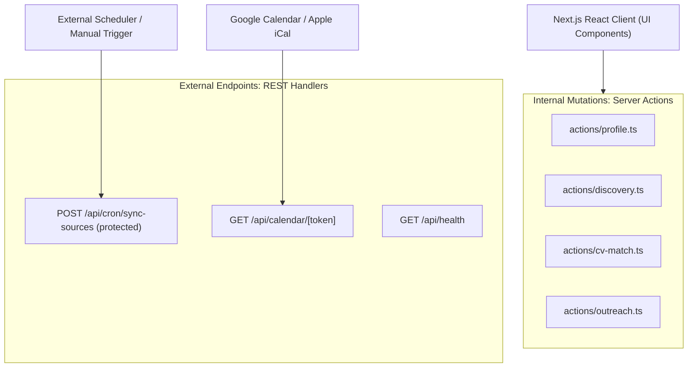

# JobFlow AI — API Design & Interface Specifications
**Document ID:** `docs/API_DESIGN.md`  
**Status:** Approved Interface Specification — aligned to `docs/EXECUTION_STRATEGY.md` v3.0  
**Version:** 3.0  
**Author:** Principal Software Architect & Senior Full-Stack Engineer  

> **Scope note.** The MVP exposes Server Actions for first-party mutations and a small number of REST handlers. There is **no LinkedIn API client** and no `OutreachQueue` resource; outreach is `MessageDraft` + `OutreachActivity` + `FollowUpTask`.

---

## 1. Interface Architecture Philosophy

JobFlow AI uses a dual-interface architecture:
1. **Next.js 16 Server Actions**: primary mechanism for first-party client-to-server operations. End-to-end TypeScript inference, built-in CSRF protection, no REST boilerplate.
2. **REST Route Handlers (`/api/*`)**: reserved for external webhooks, calendar feeds, and infrastructure probes.



---

## 2. Standard Server Action Response Envelope

All Server Actions adhere to a strict, typed response contract:

```typescript
export type ActionResponse<T> =
  | {
      success: true;
      data: T;
    }
  | {
      success: false;
      error: string;
      validationErrors?: Record<string, string[]>;
    };
```

---

## 3. Server Action Specifications

### 3.1 Profile & Career Intelligence Actions (`src/server/actions/profile.ts`)

#### `updateUserProfile(input: UserProfileInput): Promise<ActionResponse<UserProfile>>`
- **Description**: Creates or updates the user's primary professional profile, target roles, country preferences, and salary floors.
- **Input Schema**:
```typescript
export const userProfileInputSchema = z.object({
  headline: z.string().min(5).max(200),
  summary: z.string().min(20).max(5000),
  yearsOfExperience: z.number().int().min(0).max(50),
  // LEAD is added to the Prisma enum in M3; add it to this schema in the same migration.
  targetSeniority: z.enum(['INTERNSHIP', 'FRESHER', 'JUNIOR', 'MID_LEVEL', 'SENIOR']),
  targetRoles: z.array(z.string().min(1)).min(1).max(10),
  targetCountries: z.array(z.string().min(1)).min(1).max(10),
  minSalaryEgp: z.number().int().positive().optional().nullable(),
  minSalaryUsd: z.number().int().positive().optional().nullable(),
  preferredWorkModes: z.array(z.enum(['ON_SITE', 'HYBRID', 'REMOTE'])).min(1),
  githubUrl: z.string().url().optional().or(z.literal('')),
  linkedinUrl: z.string().url().optional().or(z.literal('')),
  portfolioUrl: z.string().url().optional().or(z.literal('')),
});
```

#### `upsertUserSkill(input: UserSkillInput): Promise<ActionResponse<UserSkill>>`
- **Description**: Adds or updates one skill for the current profile.
- **Validation**: Name is trimmed and normalized; `(profileId, name)` is unique.

> `ResumeVersion` actions are **deferred**. The MVP uses `Settings.cvSummary` plus `UserProfile.summary`. Do not add a resume-version API until a storage backend is chosen.

---

### 3.2 Job Discovery Actions (`src/server/actions/discovery.ts`)

#### `createJobSource(input: JobSourceInput): Promise<ActionResponse<JobSource>>`
- **Description**: Configures a Greenhouse or Lever board by token.
- **Behavior**: Probes the board before saving. `404` → `INVALID_TOKEN`; `200` with zero jobs is valid.
- **Input**:
```typescript
export const jobSourceInputSchema = z.object({
  name: z.string().min(1).max(120),
  sourceType: z.enum(['GREENHOUSE', 'LEVER']),
  boardToken: z.string().min(1).max(120).regex(/^[a-z0-9-]+$/i),
  syncFrequencyMinutes: z.number().int().min(60).max(1440).default(360),
})
```

#### `testJobSource(sourceId: string): Promise<ActionResponse<SourceProbeResult>>`
- **Description**: Re-runs the live probe and updates health fields.
- **Rate limit**: one probe per source per 10 seconds.

#### `triggerSourceSync(sourceId: string): Promise<ActionResponse<{ queued: boolean; runId?: string }>>`
- **Description**: Enqueues an `ats-sync` job with `singletonKey: source:{id}:sync`.
- **Fallback**: if `QUEUE_ENABLED=false`, runs the sync inline with a 30 s cap and returns the result.

#### `convertDiscoveredJob(jobId: string): Promise<ActionResponse<Opportunity>>`
- **Description**: Converts a `DiscoveredJob` into an `Opportunity`, creating or linking the `Company`.
- **Invariants**: tenant-scoped; idempotent (returns the existing opportunity if already converted); preserves `discoveredJobId`.

#### `dismissDiscoveredJob(jobId: string): Promise<ActionResponse<{ id: string }>>`
- **Description**: Sets `triageStatus = DISMISSED`; the job leaves the default inbox but is not deleted.

---

### 3.3 Compatibility & Match Actions (`src/server/actions/cv-match.ts`)

#### `evaluateJobMatch(input: { opportunityId?: string; discoveredJobId?: string }): Promise<ActionResponse<MatchAnalysis>>`
- **Description**: Computes deterministic component scores, optionally calls the LLM for semantic evidence, and **server-computes** the final score.
- **Invariants**: exactly one target ID; tenant-scoped; Zod-validated LLM output; cached by `inputHash`.
- **Output**:
```typescript
export interface MatchAnalysis {
  id: string
  matchScore: number              // server-computed, 0..100
  recommendation: 'STRONG_MATCH' | 'POTENTIAL_MATCH' | 'LOW_MATCH'
  techScore: number
  seniorityScore: number
  locationScore: number
  semanticScore: number | null
  confidence: 'HIGH' | 'MEDIUM' | 'LOW'
  matchedSkills: string[]
  missingSkills: string[]
  rationale: string | null
  scoringVersion: string
}
```

> The LLM never returns `matchScore` or `recommendation`. See `docs/AI_AGENT_DESIGN.md` §2.2.

---

### 3.4 Outreach Actions (`src/server/actions/outreach.ts`)

#### `createMessageDraft(input: CreateDraftInput): Promise<ActionResponse<MessageDraft>>`
- **Description**: Generates and stores a draft for a contact/opportunity. Status starts as `DRAFT`.
- **Validation**: contact and opportunity belong to the session user; language/tone/goal are valid enums.

#### `approveMessageDraft(draftId: string): Promise<ActionResponse<MessageDraft>>`
- **Description**: Marks the draft `APPROVED` after the user reviews it. No send occurs.

#### `markDraftSent(draftId: string): Promise<ActionResponse<{ activityId: string; followUpTaskId: string }>>`
- **Description**: Records the manual send.
- **Side effects (exactly once)**: set `status = SENT`, `sentAt = now()`, create one `OutreachActivity`, create one `FollowUpTask` due in `Settings.followUpDefaultDays`.
- **Idempotency**: if already `SENT`, return the existing activity/follow-up IDs; do not duplicate.

> There is no `stageOutreachItem`/`OutreachQueue` resource. The daily outbox is a query over approved drafts, not a new table.

---

## 4. REST Route Handler Specifications

### 4.1 Health Probe
- **Route**: `GET /api/health`
- **Auth**: none (public liveness); no sensitive data.
- **Behavior**: returns `{ status: 'ok', time }`. Optionally checks the DB with a 1 s timeout; do not start a queue manager from this route.

### 4.2 Calendar Feed Export
- **Route**: `GET /api/calendar/[token]`
- **Authentication**: unguessable token in the path (`Settings.calendarFeedToken`); constant-time comparison.
- **Content-Type**: `text/calendar; charset=utf-8`
- **Behavior**: generates an RFC 5545 `.ics` file with interview rounds and pending follow-up deadlines. No other user data.

### 4.3 Protected Sync Trigger (fallback scheduler)
- **Route**: `POST /api/cron/sync-sources`
- **Authentication**: `Authorization: Bearer $CRON_SECRET` (constant-time compare).
- **Behavior**: when `QUEUE_ENABLED=false`, runs due source syncs inline with a hard time cap; when true, enqueues `ats-sync` jobs.
- **Idempotency**: `singletonKey` per source; overlapping calls return `{ queued: false }`.

### 4.4 Inbound Email Webhook — deferred
- **Route**: `POST /api/webhooks/inbound-email` (not part of the MVP).
- **Future requirements**: HMAC-SHA256 verification, timestamp freshness, sender allowlist, and a dedicated parser queue.
- **Status**: do not implement until the Greenhouse/Lever loop is stable.

---

## 5. Cross-Cutting API Rules

1. **Auth first**: every action calls `requireAuth()` before parsing input.
2. **Tenant scoping**: derive `userId` from the session; never accept it from the client.
3. **Zod at the boundary**: parse `FormData`/JSON with a schema; return `validationErrors` keyed by field.
4. **Idempotency**: convert, sync, and mark-sent are safe to retry. Use natural keys and status checks.
5. **Rate limits**: AI actions 10/min and 100/day; probe/sync 1 per source per 10 s.
6. **No LinkedIn calls**: no action fetches LinkedIn; links are navigation only.
7. **Error hygiene**: map internal errors to safe codes (`SSRF_BLOCKED`, `INVALID_TOKEN`, `RATE_LIMITED`, `NOT_FOUND`, `CONFLICT`); never return stack traces or internal IPs.
8. **Audit**: stage transitions, conversions, sends, and follow-up creation write an audit row.

