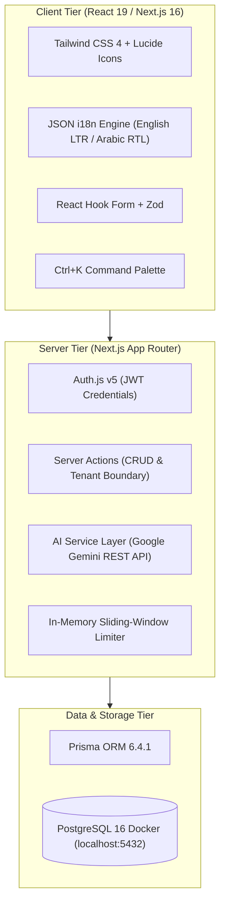
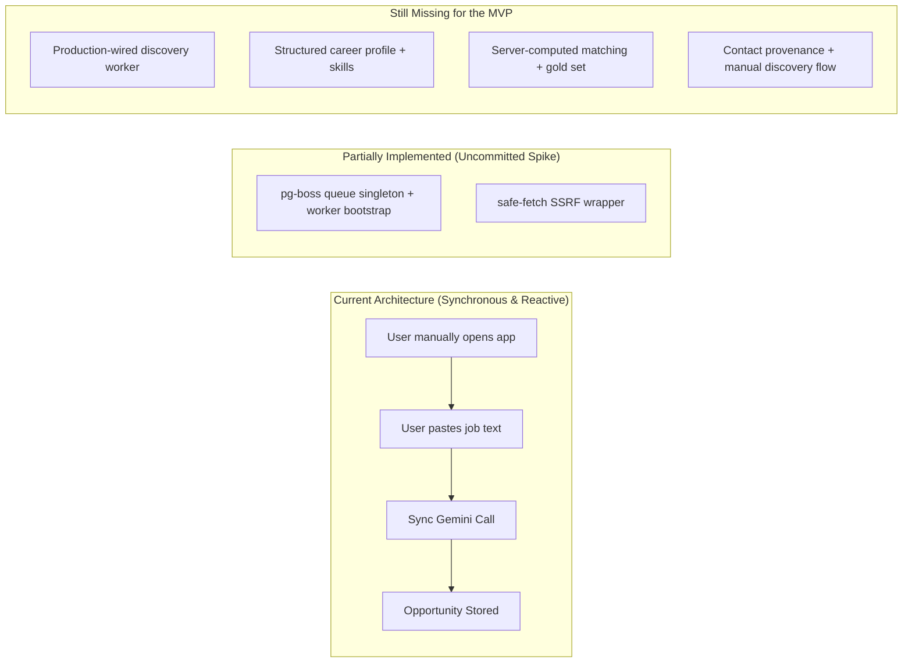

# JobFlow AI — Current State Codebase Audit
**Document ID:** `docs/CURRENT_STATE_AUDIT.md`  
**Status:** Approved Technical Audit — with post-audit delta  
**Audit Date:** 2026-10-31  
**Target Project:** `F:\AI Job Networking Assistant\ai_job_assistant`

> **Post-audit delta (same day).** The working tree now contains uncommitted Phase 0-style work that was not present when the audit began: `src/lib/security/safe-fetch.ts`, `src/server/queue/boss.ts`, `src/server/worker/index.ts`, `tests/security/safe-fetch.test.ts`, `tests/queue/worker.test.ts`, `pg-boss`/`tsx`/`@opentelemetry/api` in `package.json`, and `safeFetch` wired into `parseJobPostingAction`. This is a **partially implemented spike**, not production-ready infrastructure. Gaps 1 and 5 below are therefore “partially addressed, incomplete” rather than “absent.” The `pgboss` schema exists locally.

---

## 1. Executive Summary & Technology Stack

The codebase represents a modern, production-structured full-stack Next.js web application operating as a single-owner job search and networking CRM. The system is designed for high-conversion job searching in Egypt, the MENA region, and international remote markets.

### Verified Technology Stack
| Layer | Technology | Version | Purpose |
| :--- | :--- | :--- | :--- |
| **Framework** | Next.js (App Router) | `16.4.3` (Turbopack) | Server actions, route handlers, server-side rendering |
| **Runtime / UI** | React / React DOM | `19.3.0` | Component lifecycle, modern hooks, transitions |
| **Language** | TypeScript | `5.9.3` | End-to-end static typing across database, API, and UI |
| **Styling** | Tailwind CSS | `4.3.3` | Design tokens, responsive layouts, RTL support |
| **Database** | PostgreSQL | `16` (Alpine) | Relational persistence in Docker container `jobflow-postgres` |
| **ORM** | Prisma ORM | `6.4.1` | Schema management, migrations, typed data access layer |
| **Authentication** | Auth.js (NextAuth) | `5.0.0-beta.32` | JWT credentials provider, cookie-based session protection |
| **Data Validation** | Zod | `4.6.7` | Input validation schemas on client and server boundaries |
| **Data Visuals** | Recharts | `3.10.1` | Pipeline funnel, stage velocity, and rejection breakdown charts |
| **Testing** | Vitest | `5.0.5` | Fast unit and integration testing harness |
| **AI LLM** | Google Gemini API | `v1beta` (REST) | `gemini-flash-latest` model for job extraction, ATS matching, messages |

---

## 2. Comprehensive Database & Data Model Audit

The schema is defined in [`prisma/schema.prisma`](file:///f:/AI%20Job%20Networking%20Assistant/ai_job_assistant/prisma/schema.prisma) and consists of **19 relational models and 14 enums** mapped to snake_case PostgreSQL tables. One migration is applied and `prisma migrate status` is clean.

### 2.1 Model Classification & Status
| Model Name | Table Name | Status | Functionality & Usage |
| :--- | :--- | :--- | :--- |
| `User` | `users` | **Active** | Primary tenant. Stores email and name; credentials are env-based for the single-owner MVP (no password hash column). |
| `Settings` | `settings` | **Active** | User preferences, target role, country, `cvSummary` text, calendar token. |
| `Company` | `companies` | **Active** | Target employers, hiring notes, priority, tech stack, locations. |
| `Contact` | `contacts` | **Active** | Industry professionals across 9 relationship stages with follow-up timers. |
| `Opportunity` | `opportunities` | **Active** | Job postings across 9 pipeline stages with compensation and source metadata. |
| `ContactsOnOpportunities` | `contacts_on_opportunities` | **Active** | Join table linking decision-makers and recruiters directly to specific jobs. |
| `MessageDraft` | `message_drafts` | **Active** | Generated outreach messages, tone, dialect, status, and approval tracking. |
| `MessageRevision` | `message_revisions` | **Active** | Immutable history of AI-regenerated message variants. |
| `OutreachActivity` | `outreach_activities` | **Active** | Timeline logging for touches, emails sent, and connection requests. |
| `FollowUpTask` | `follow_up_tasks` | **Active** | Actionable follow-up board with due dates, priority, and states. |
| `CommunicationEntry` | `communication_entries` | **Partial** | Schema exists; basic log creation works, but lacks dedicated rich UI. |
| `Tag` / `TagsOn*` | `tags`, `tags_on_*` | **Partial** | Tables exist for generic tagging; currently unexposed in primary UI. |
| `OpportunityMatchAnalysis` | `opportunity_match_analyses` | **Active** | Stores calculated 0–100 ATS scores, missing skills, and tailored bullets. |
| `OpportunityStageHistory` | `opportunity_stage_histories` | **Active** | Audit trail recording all stage transitions with timestamps for velocity metrics. |
| `InterviewRound` | `interview_rounds` | **Active** | Tracks interview stages (Screen, Coding, System Design, Behavioral). |
| `StarStory` | `star_stories` | **Active** | STAR framework stories linked to specific interview rounds and skills. |

### 2.2 Relational Integrity & Tenant Isolation
- **Tenant Isolation**: Every top-level entity (`Company`, `Contact`, `Opportunity`, `FollowUpTask`, `MessageDraft`, `Settings`, `StarStory`) enforces a foreign key constraint referencing `users.id` with `onDelete: Cascade`.
- **Query Scoping**: Server data helpers (`src/server/data/*.ts`) and server actions (`src/server/actions/*.ts`) verify `userId` against the authenticated session before executing queries, preventing cross-tenant data leaks.
- **Indexes**: Composite indexes exist on high-frequency queries:
  - `contacts(userId, relationshipStatus)`
  - `opportunities(userId, status)`
  - `opportunities(userId, createdAt)`
  - `follow_up_tasks(userId, state, dueDate)`

---

## 3. Feature-by-Feature Operational Assessment

### 3.1 Authentication & Session Management
- **Files**: [`src/server/auth.ts`](file:///f:/AI%20Job%20Networking%20Assistant/ai_job_assistant/src/server/auth.ts), [`src/lib/auth.ts`](file:///f:/AI%20Job%20Networking%20Assistant/ai_job_assistant/src/lib/auth.ts), [`app/login/page.tsx`](file:///f:/AI%20Job%20Networking%20Assistant/ai_job_assistant/app/login/page.tsx).
- **Current State**: Uses NextAuth v5 JWT strategy. Protects routes via `requireAuth()` server helper. Single-tenant model initialized with seed user.
- **Assessment**: Stable and functional. Unit tested via `tests/security/auth-boundary.test.ts`.

### 3.2 Dashboard & Daily Next Best Action
- **Files**: [`app/(dashboard)/page.tsx`](file:///f:/AI%20Job%20Networking%20Assistant/ai_job_assistant/app/\(dashboard\)/page.tsx), [`src/components/dashboard/next-best-action.tsx`](file:///f:/AI%20Job%20Networking%20Assistant/ai_job_assistant/src/components/dashboard/next-best-action.tsx), [`src/lib/planner/next-best-action.ts`](file:///f:/AI%20Job%20Networking%20Assistant/ai_job_assistant/src/lib/planner/next-best-action.ts).
- **Current State**: Evaluates overdue follow-ups, today's tasks, stale contacts (>14 days without touchpoint), and daily networking targets. Displays prioritized action cards with deep links.
- **Assessment**: Fully operational with deterministic scoring algorithm.

### 3.3 Opportunities & Pipeline Management
- **Files**: [`app/(dashboard)/opportunities/page.tsx`](file:///f:/AI%20Job%20Networking%20Assistant/ai_job_assistant/app/\(dashboard\)/opportunities/page.tsx), [`src/components/opportunities/opportunity-board.tsx`](file:///f:/AI%20Job%20Networking%20Assistant/ai_job_assistant/src/components/opportunities/opportunity-board.tsx).
- **Current State**:
  - Full Kanban board supporting 9 stages (`SAVED` to `CLOSED`).
  - Table view with sorting, filtering, and multi-field search.
  - Job Posting Importer modal: Uses Google Gemini API (`src/lib/ai/job-parser.ts`) to extract title, company, stack, salary bounds, and seniority from raw text or job URLs.
  - ATS Match Analysis: Calculates score, missing skills, and cover letter draft (`src/lib/ai/cv-matcher.ts`).
  - Interview Prep Section: Generates targeted technical questions, behavioral prompts, and STAR story builder.
- **Assessment**: Rich and responsive. Stage transitions correctly record to `OpportunityStageHistory`.

### 3.4 Contacts CRM & Relationship Funnel
- **Files**: [`app/(dashboard)/contacts/page.tsx`](file:///f:/AI%20Job%20Networking%20Assistant/ai_job_assistant/app/\(dashboard\)/contacts/page.tsx), [`src/components/contacts/contact-list.tsx`](file:///f:/AI%20Job%20Networking%20Assistant/ai_job_assistant/src/components/contacts/contact-list.tsx).
- **Current State**: 9 relationship stages (`TO_RESEARCH` to `ARCHIVED`), company linkage, category badges (`RECRUITER`, `TECH_LEAD`, `ENGINEERING_MANAGER`), and quick action buttons to generate outreach messages.
- **Assessment**: Fully functional.

### 3.5 AI Outreach Message Studio
- **Files**: [`app/(dashboard)/messages/page.tsx`](file:///f:/AI%20Job%20Networking%20Assistant/ai_job_assistant/app/\(dashboard\)/messages/page.tsx), [`src/lib/ai/message-generator.ts`](file:///f:/AI%20Job%20Networking%20Assistant/ai_job_assistant/src/lib/ai/message-generator.ts).
- **Current State**: Supports 3 dialects (`EGYPTIAN_ARABIC`, `ENGLISH`, `MSA`), 3 tones (`CONCISE_DIRECT`, `FRIENDLY_PROFESSIONAL`, `FORMAL`), and 7 message goals. Includes revision history and template fallback if AI is unavailable.
- **Assessment**: Robust. Protected by rate limiter (`10 requests / 60 seconds`).

### 3.6 Analytics & Velocity Metrics
- **Files**: [`app/(dashboard)/analytics/page.tsx`](file:///f:/AI%20Job%20Networking%20Assistant/ai_job_assistant/app/\(dashboard\)/analytics/page.tsx), [`src/components/analytics/stage-velocity-chart.tsx`](file:///f:/AI%20Job%20Networking%20Assistant/ai_job_assistant/src/components/analytics/stage-velocity-chart.tsx), [`src/components/analytics/rejection-breakdown.tsx`](file:///f:/AI%20Job%20Networking%20Assistant/ai_job_assistant/src/components/analytics/rejection-breakdown.tsx).
- **Current State**: Computes average days spent per stage from historical transitions and groups rejections by category (`TECH_STACK_GAP`, `SALARY_MISMATCH`, `GHOSTED`, etc.).
- **Assessment**: High-value metrics rendered with Recharts.

### 3.7 Internationalization (i18n) & Arabic RTL
- **Files**: [`src/lib/i18n.tsx`](file:///f:/AI%20Job%20Networking%20Assistant/ai_job_assistant/src/lib/i18n.tsx), [`src/locales/en.json`](file:///f:/AI%20Job%20Networking%20Assistant/ai_job_assistant/src/locales/en.json), [`src/locales/ar.json`](file:///f:/AI%20Job%20Networking%20Assistant/ai_job_assistant/src/locales/ar.json).
- **Current State**: React context provider with instant toggling between English (LTR) and Arabic (RTL). Updates document `<html dir="rtl" lang="ar">` dynamically.
- **Assessment**: Fully integrated across dashboard, navigation, forms, and dialogs.

---

## 4. Architectural Gaps & Technical Limitations

While the existing CRM is well-engineered, transforming it into an **autonomous AI agent platform** exposes several gaps. Some are now partially addressed by uncommitted work; none are production-complete.

### Gap 1: Background worker is a spike, not production infrastructure
- **Issue**: `src/server/queue/boss.ts` and `src/server/worker/index.ts` exist, but only a `system-probe` handler and tests use them. `sendJob()` catches all errors and starts a manager; `ensureQueue()` swallows errors; `isQueueHealthy()` starts a manager without stopping it. No real discovery consumer exists.
- **Required solution**: Treat this as **M0B**, a time-boxed feasibility spike. Wire a real `ats-sync` consumer only in M2, with idempotent handlers, retries, dead-letter, and graceful shutdown. If the host cannot run a long-lived worker, use manual sync + an external scheduler instead.
- **Version note**: installed `pg-boss` is `12.38.0` (Node `>=22.12.0`), not the v10 API described in earlier planning docs.

### Gap 2: Primitive profile & CV storage
- **Issue**: CV data is an unstructured `cvSummary` blob in `Settings`. It cannot support structured skill matching or target preferences.
- **Required solution (MVP)**: Add `UserProfile` + `UserSkill` only. Defer `WorkExperience`, `EducationEntry`, and `ResumeVersion` until the matching loop is proven and a storage backend exists.

### Gap 3: No automated job ingestion pipeline
- **Issue**: Opportunities only enter when the user manually triggers the import dialog.
- **Required solution (MVP)**: Greenhouse and Lever adapters, normalization, dedup, delisting, source health, and a triage inbox. Email-alert ingestion and RSS are deferred.

### Gap 4: No unified outreach review flow
- **Issue**: Drafts are scattered across contacts and opportunities; there is no daily review surface.
- **Required solution (MVP)**: A read view over approved `MessageDraft` rows plus `OutreachActivity` and `FollowUpTask`. **Do not add `OutreachQueue`**; the existing tables already model the loop. Add a dispatch table only when multi-channel scheduling requires it.

### Gap 5: SSRF protection is incomplete
- **Issue**: `safe-fetch.ts` validates DNS and then calls `fetch()`, which resolves again (rebinding TOCTOU). It checks `Content-Length` but does not cap chunked/streamed bodies. IPv4-mapped IPv6 forms are not fully covered.
- **Required solution**: M0A hardening — DNS pinning, streamed body cap, IPv4-mapped IPv6/NAT64 handling, content-type allowlist, redirect re-validation, typed errors, and tests.

### Gap 6: Matching score is LLM-owned
- **Issue**: `src/lib/ai/cv-matcher.ts` parses `matchScore` directly from model JSON with no Zod validation.
- **Required solution (M3)**: Server computes the final score from tech/seniority/location/semantic components; the LLM returns only validated evidence. See `docs/AI_AGENT_DESIGN.md` §2.2.

### Gap 7: Enum and prompt drift
- **Issue**: `job-parser.ts` emits `ONSITE`, `MID`, `LEAD`; the schema uses `ON_SITE`, `MID_LEVEL`, and has no `LEAD`. Docs sometimes say `INTERVIEWING`; the schema uses `INTERVIEW`.
- **Required solution**: Normalize parser output to schema values; add `LEAD` deliberately in M3; fix docs.

### Gap 8: Dependency and script hygiene
- **Issue**: `@opentelemetry/api` is installed but no SDK is configured, so spans are no-ops. `package.json` still has `"postinstall": "prisma skills sync || exit 0"`, which is not a valid Prisma command.
- **Required solution**: Add an SDK in the worker milestone or remove the dependency; replace `postinstall` with `prisma generate`.

---

## 5. Preservation, Refactoring, and Deprecation Strategy

| Code Area | Recommendation | Justification |
| :--- | :--- | :--- |
| **Prisma Schema Core** | **Preserve** | Existing `opportunities`, `contacts`, `companies`, `follow_up_tasks`, and `message_drafts` tables have clean relationships and validated indexes. |
| **UI Components & Theme** | **Preserve** | Tailwind 4 design system, modal dialogs, Recharts components, and RTL support are robust and modern. |
| **Auth.js v5 JWT Flow** | **Preserve** | Secure session management with tenant boundaries verified by automated test suites. |
| **Settings Schema** | **Refactor** | Retain UI preferences, but move career targets and CV summary into `UserProfile` with a one-way backfill. `ResumeVersion` is deferred. |
| **Job Parser & Matcher** | **Refactor** | Normalize parser enums; move final scoring to the server; use Zod for all LLM output. Keep the manual paste path as a fallback. |
| **Static Form Imports** | **Augment** | Retain manual paste, add Greenhouse/Lever adapters. Do not add email/RSS ingestion in the MVP. |
| **Queue & SSRF Spike** | **Harden, then wire** | Fix lifecycle and SSRF gaps in M0A/M0B before any production consumer. |

