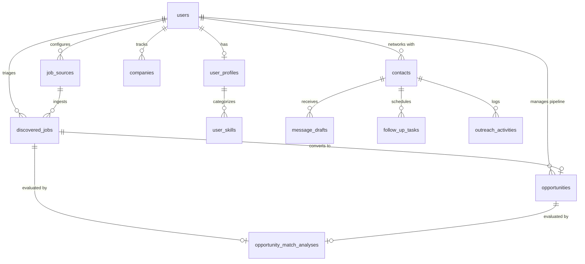

# JobFlow AI — Database Schema Design & Migration Strategy

**Document ID:** `docs/DATABASE_DESIGN.md`  
**Status:** Approved Architectural Blueprint — aligned to `docs/EXECUTION_STRATEGY.md` v3.0  
**Version:** 3.0 (JIT MVP scope)  
**Author:** Principal Database Architect & Senior Full-Stack Engineer  

> **Scope of this revision.** The schema is delivered just-in-time. Only models consumed by the milestone being built are added. `prisma db push` is prohibited outside a disposable local sandbox. The MVP adds **four tables** and **extends three existing tables**; everything else is explicitly deferred.

---

## 1. Baseline (verified 2026-10-31)

- `prisma/schema.prisma` contains **19 models** and **14 enums**.
- One migration: `prisma/migrations/20261027000000_init/migration.sql`.
- `npx prisma migrate status` → “Database schema is up to date.”
- `_prisma_migrations` contains one finished migration.
- Local database has `public` (Prisma) and `pgboss` (queue) schemas.
- `SHADOW_DATABASE_URL` exists in local `.env`; it must be added to `.env.example`.
- Existing data: 1 user; 0 companies, contacts, opportunities, follow-ups, drafts.

### 1.1 Existing models that the MVP reuses

| Area | Existing model(s) | Reuse decision |
|---|---|---|
| Identity | `User`, `Settings` | Keep. `Settings` remains app preferences; career facts move to `UserProfile`. |
| Companies | `Company` | Keep. Link discovered jobs to a company on conversion. |
| Pipeline | `Opportunity`, `OpportunityStageHistory` | Keep. `INTERVIEW` is the canonical enum value. |
| Matching | `OpportunityMatchAnalysis` | **Extend**; do not add `JobMatch`. |
| Contacts | `Contact`, `ContactsOnOpportunities` | **Extend** `Contact` with source provenance. |
| Outreach | `MessageDraft`, `MessageRevision`, `OutreachActivity` | Keep. This is the outreach loop. |
| Follow-up | `FollowUpTask` | **Extend** with `completedAt`. |
| Interviews | `InterviewRound`, `StarStory` | Keep; out of MVP scope. |
| Tags | `Tag`, `TagsOnCompanies`, `TagsOnContacts`, `TagsOnOpportunities` | Keep; single-owner global tag names are acceptable. |

---

## 2. MVP Entity-Relationship Overview



### 2.1 What is deliberately absent

| Deferred model | Why it is not in the MVP | When to revisit |
|---|---|---|
| `WorkExperience`, `EducationEntry` | Profile summary + skills are enough to score jobs; structured history adds UI and migration cost without proving the loop. | After matching quality is measured. |
| `ResumeVersion` | `pdfStoragePath` assumes a storage backend that does not exist; `Settings.cvSummary` is sufficient. | When a storage provider and multi-resume tailoring are in scope. |
| `JobMatch` | Duplicates `OpportunityMatchAnalysis`. | Never, unless the existing table proves insufficient. |
| `OutreachQueue` | Duplicates `MessageDraft` + `OutreachActivity` + `FollowUpTask`. | Only when multi-channel scheduling needs a dispatch table. |
| `AgentTask` | Duplicates pg-boss job state. | Only if the UI needs durable run history; prefer a small `job_runs` audit table. |
| `QueueChannel`, `QueueStatus`, `AgentTaskType`, `AgentTaskStatus` | Only exist to support the deferred tables. | With their tables. |

---

## 3. MVP Schema Additions

### 3.1 Enums

```prisma
enum SkillCategory {
  FRONTEND
  BACKEND
  DATABASE
  DEVOPS_CLOUD
  ARCHITECTURE
  TESTING
  SOFT_SKILL
  TOOL
}

enum SkillProficiency {
  BEGINNER
  INTERMEDIATE
  ADVANCED
  EXPERT
}

enum JobSourceType {
  GREENHOUSE
  LEVER
}

enum JobSourceStatus {
  ACTIVE
  PAUSED
  DEGRADED
  ERROR
  INVALID
}

enum DiscoveredJobStatus {
  NEW
  EVALUATED
  DISMISSED
  CONVERTED
}

enum MatchRecommendation {
  STRONG_MATCH       // server score >= 80
  POTENTIAL_MATCH    // 60 <= server score < 80
  LOW_MATCH          // server score < 60
}

enum MatchConfidence {
  HIGH
  MEDIUM
  LOW
}

enum ContactSourceType {
  MANUAL
  REFERRAL
  COMPANY_PAGE
  GITHUB
  COMMUNITY
  OTHER
}

// Additive change to the existing enum (M3)
enum ExperienceLevel {
  INTERNSHIP
  FRESHER
  JUNIOR
  MID_LEVEL
  SENIOR
  LEAD
  UNKNOWN
}
```

> `LEAD` is added in M3, not now. `STAFF` and `PRINCIPAL` map to `LEAD` for MVP so the enum does not grow speculatively.

### 3.2 Profile models (M1)

```prisma
model UserProfile {
  id                 String            @id @default(uuid()) @db.Uuid
  userId             String            @unique @db.Uuid
  user               User              @relation(fields: [userId], references: [id], onDelete: Cascade)

  headline           String            // "Senior React & Next.js Engineer | 6+ YOE"
  summary            String            @db.Text
  yearsOfExperience  Int               @default(0)
  targetSeniority    ExperienceLevel   @default(SENIOR)
  targetRoles        String[]          @default([])
  targetCountries    String[]          @default([])
  minSalaryEgp       Int?
  minSalaryUsd       Int?
  preferredWorkModes WorkArrangement[] @default([REMOTE, HYBRID])
  githubUrl          String?
  linkedinUrl        String?
  portfolioUrl       String?

  skills             UserSkill[]

  createdAt          DateTime          @default(now())
  updatedAt          DateTime          @updatedAt

  @@map("user_profiles")
}

model UserSkill {
  id          String           @id @default(uuid()) @db.Uuid
  profileId   String           @db.Uuid
  profile     UserProfile      @relation(fields: [profileId], references: [id], onDelete: Cascade)

  name        String           // "Next.js", "TypeScript", "Tailwind CSS"
  category    SkillCategory    @default(FRONTEND)
  proficiency SkillProficiency @default(ADVANCED)
  yearsExp    Int              @default(0)
  isTopSkill  Boolean          @default(false)

  createdAt   DateTime         @default(now())

  @@unique([profileId, name])
  @@index([profileId])
  @@index([name])
  @@map("user_skills")
}
```

Notes:

- `targetRoles`/`targetCountries` default to empty arrays; the UI requires at least one of each before discovery.
- `UserProfile` is the single source of truth for career data. `Settings.cvSummary` is only a read fallback during backfill.
- `@@unique([profileId, name])` prevents duplicate skills; normalize names in the action layer.

### 3.3 Discovery models (M2)

```prisma
model JobSource {
  id                   String          @id @default(uuid()) @db.Uuid
  userId               String          @db.Uuid
  user                 User            @relation(fields: [userId], references: [id], onDelete: Cascade)

  name                 String          // "Careem — Greenhouse"
  sourceType           JobSourceType
  boardToken           String          // Greenhouse/Lever slug
  syncFrequencyMinutes Int             @default(360)
  status               JobSourceStatus @default(ACTIVE)

  lastProbedAt         DateTime?
  lastSyncedAt         DateTime?
  lastSuccessAt        DateTime?
  lastErrorCode        String?         // INVALID_TOKEN | RATE_LIMITED | BLOCKED | TRANSIENT | MALFORMED | TIMEOUT
  lastErrorMessage     String?
  consecutiveFailures  Int             @default(0)

  discoveredJobs       DiscoveredJob[]

  createdAt            DateTime        @default(now())
  updatedAt            DateTime        @updatedAt

  @@unique([userId, sourceType, boardToken])
  @@index([userId, status])
  @@index([sourceType, status])
  @@map("job_sources")
}

model DiscoveredJob {
  id              String              @id @default(uuid()) @db.Uuid
  userId          String              @db.Uuid
  user            User                @relation(fields: [userId], references: [id], onDelete: Cascade)

  sourceId        String              @db.Uuid
  source          JobSource           @relation(fields: [sourceId], references: [id], onDelete: Cascade)

  externalId      String              // GREENHOUSE:{token}:{id} | LEVER:{token}:{id}
  companyName     String
  companyKey      String
  title           String
  titleKey        String
  locationText    String?
  workArrangement WorkArrangement     @default(UNKNOWN)
  employmentType  String?
  department      String?
  descriptionText String              @db.Text
  descriptionHash String
  jobUrl          String
  applyUrl        String?
  publishedAt     DateTime?
  sourceUpdatedAt DateTime?
  salaryMin       Int?
  salaryMax       Int?
  salaryCurrency  String?

  fingerprint     String
  duplicateOfId   String?             @db.Uuid
  duplicateOf     DiscoveredJob?      @relation("JobDuplicates", fields: [duplicateOfId], references: [id], onDelete: SetNull)
  duplicates      DiscoveredJob[]     @relation("JobDuplicates")

  triageStatus    DiscoveredJobStatus @default(NEW)
  isActive        Boolean             @default(true)
  firstSeenAt     DateTime            @default(now())
  lastSeenAt      DateTime            @default(now())
  closedAt        DateTime?

  opportunityId   String?             @unique @db.Uuid
  opportunity     Opportunity?        @relation(fields: [opportunityId], references: [id], onDelete: SetNull)

  matchAnalysis   OpportunityMatchAnalysis?

  createdAt       DateTime            @default(now())
  updatedAt       DateTime            @updatedAt

  @@unique([userId, sourceId, externalId])
  @@index([userId, triageStatus, isActive])
  @@index([userId, fingerprint])
  @@index([userId, companyKey])
  @@index([sourceId, lastSeenAt])
  @@map("discovered_jobs")
}
```

Notes:

- `sourceId` is required: every discovered job has provenance. No anonymous rows.
- `externalId` is namespaced, so two ATS providers cannot collide on a numeric ID.
- `fingerprint` excludes description so content edits do not create a new duplicate.
- `duplicateOfId` is self-referential; a canonical row has `duplicateOfId = null`.
- `opportunityId @unique` preserves the one-to-one conversion link; `onDelete: SetNull` leaves the discovered row intact if the opportunity is deleted.
- `descriptionText` replaces the old `rawContent` proposal. Raw HTML is not retained by default; if needed, store it behind a short retention policy.

### 3.4 Matching extension (M3)

```prisma
model OpportunityMatchAnalysis {
  id               String             @id @default(uuid()) @db.Uuid
  userId           String             @db.Uuid
  user             User               @relation(fields: [userId], references: [id], onDelete: Cascade)

  opportunityId    String?            @unique @db.Uuid
  opportunity      Opportunity?       @relation(fields: [opportunityId], references: [id], onDelete: Cascade)

  discoveredJobId  String?            @unique @db.Uuid
  discoveredJob    DiscoveredJob?     @relation(fields: [discoveredJobId], references: [id], onDelete: Cascade)

  matchScore       Int                // server-computed, 0..100
  recommendation   MatchRecommendation
  techScore        Int
  seniorityScore   Int
  locationScore    Int
  semanticScore    Int?               // null when the LLM is unavailable
  confidence       MatchConfidence    @default(LOW)

  matchedSkills    String[]           @default([])
  missingSkills    String[]           @default([])
  tailoredBullets  String[]           @default([])
  coverLetterDraft String?            @db.Text
  rationale        String?            @db.Text

  scoringVersion   String             // e.g. "matching-v1"
  model            String?            // e.g. "gemini-flash-latest"
  inputHash        String             // SHA-256 of normalized profile + job
  analyzedAt       DateTime           @default(now())

  @@index([userId, matchScore])
  @@index([recommendation])
  @@index([discoveredJobId])
  @@map("opportunity_match_analyses")
}
```

Migration requirements beyond Prisma:

```sql
-- Exactly one target per analysis
ALTER TABLE "opportunity_match_analyses"
  ADD CONSTRAINT "match_analysis_one_target"
  CHECK (("opportunityId" IS NOT NULL) <> ("discoveredJobId" IS NOT NULL));
```

Notes:

- `opportunityId` becomes nullable; existing rows (currently zero) are backfilled with `userId` from the joined opportunity.
- The LLM never writes `matchScore`; the server computes it from component scores.
- `inputHash` enables cache/recompute decisions without another model call.

### 3.5 Contact and follow-up extensions (M4)

```prisma
model Contact {
  // ... existing fields unchanged ...

  sourceType     ContactSourceType @default(MANUAL)
  lastVerifiedAt DateTime?

  @@unique([userId, profileUrl])   // Postgres allows multiple NULLs
}
```

```prisma
model FollowUpTask {
  // ... existing fields unchanged ...

  completedAt DateTime?
}
```

Notes:

- `@@unique([userId, profileUrl])` is a native Prisma unique constraint; Postgres permits many `NULL` values, so contacts without a URL are unaffected. Normalize URLs (lowercase host, strip tracking query params and trailing slash) before insert, and store “no URL” as `NULL`, never `''`.
- `completedAt` is set when `state` moves to `DONE`; it powers cadence and velocity metrics.
- No new contact stages. The existing `RelationshipStatus` enum is sufficient.

### 3.6 Required edits to existing models

Prisma requires both sides of every relation. Add these fields when the corresponding migration lands.

```prisma
model User {
  // ... existing fields unchanged ...

  profile        UserProfile?
  jobSources     JobSource[]
  discoveredJobs DiscoveredJob[]
  matchAnalyses  OpportunityMatchAnalysis[]
}
```

```prisma
model Opportunity {
  // ... existing fields unchanged ...

  discoveredJob DiscoveredJob?
}
```

The `Contact` and `FollowUpTask` edits are shown in §3.5. Do **not** add `OutreachQueue`, `AgentTask`, `JobMatch`, `ResumeVersion`, `WorkExperience`, or `EducationEntry` in the MVP.

---

## 4. Migration-First Workflow

### 4.1 Development

```bash
npx prisma migrate dev --name add_user_profile_and_skills
```

1. Review the generated SQL **before** committing.
2. Reject unintended `DROP TABLE`, `DROP COLUMN`, narrowing `ALTER COLUMN`, or missing backfills.
3. Commit the migration directory and the schema change together.
4. Run `npx prisma generate`.

### 4.2 CI drift gate

```bash
npx prisma validate

npx prisma migrate diff \
  --from-migrations prisma/migrations \
  --to-schema-datamodel prisma/schema.prisma \
  --shadow-database-url "$SHADOW_DATABASE_URL" \
  --exit-code
```

A non-zero exit fails the build. This catches a schema edited without a matching migration (and vice versa).

### 4.3 Production

```bash
npx prisma migrate deploy
```

- Run once per release, as a release step — never at application boot and never from every replica.
- Take a backup first; include the `pgboss` schema in backups.
- Set a `statement_timeout` for the migration session.
- Verify `_prisma_migrations` after deploy.
- Never edit an already-applied migration.

### 4.4 Prohibited operations

| Operation | Status | Reason |
|---|---|---|
| `prisma db push` on staging/production | **Prohibited** | Bypasses migration history; causes silent drift. |
| `prisma migrate reset` on shared environments | **Prohibited** | Destroys data. Local disposable DB only. |
| Editing an applied migration | **Prohibited** | Breaks checksums and replay. |
| Destructive change in the same release as its dependent feature | **Prohibited** | No rollback window. Use expand/contract. |
| Long-running backfill inside the migration transaction | **Discouraged** | Locks tables; run a batched backfill after deploy. |

---

## 5. Expand/Contract for Breaking Changes

Example: making `OpportunityMatchAnalysis.opportunityId` nullable and adding `discoveredJobId`.

1. **Expand (M3 migration):** add `userId`, `discoveredJobId`, component scores, and metadata; keep `opportunityId`.
2. **Backfill:** `UPDATE ... SET "userId" = o."userId" FROM opportunities o WHERE o.id = "opportunityId"`; leave `discoveredJobId` null.
3. **Switch:** make `opportunityId` nullable; add the XOR check constraint.
4. **Contract:** remove legacy columns only after two releases and only if unused.

The same pattern applies to `Contact.profileUrl` uniqueness: normalize and backfill first, then add the constraint in a separate migration if duplicates exist.

---

## 6. Backfill: `Settings` → `UserProfile`

1. M1 creates `UserProfile` and `UserSkill`.
2. On first profile read, if no `UserProfile` exists, derive a draft from `Settings`:
   - `preferredRole` → `targetRoles[0]`
   - `targetCountry` → `targetCountries[0]`
   - `preferredExperience` → `targetSeniority` (best-effort mapping)
   - `workPreference` → `preferredWorkModes[0]`
   - `cvSummary` → `summary`
3. Show the draft in the UI; write it only when the user saves.
4. Matching reads `UserProfile`; if absent, falls back to `Settings` and sets `confidence = LOW`.
5. Never dual-write the same form to both tables.
6. Remove duplicated `Settings` fields only in a later, separate migration.

---

## 7. Migration Names and Impact

| Milestone | Migration | Impact | Rollback |
|---|---|---|---|
| **M0A** | none | None | Revert code; no DB action. |
| **M1** | `add_user_profile_and_skills` | Creates `user_profiles`, `user_skills`; adds `User.profile` relation. Additive. | Drop the two tables or leave them; no existing data touched. |
| **M2** | `add_job_discovery` | Creates `job_sources`, `discovered_jobs`; adds `Opportunity.discoveredJob`. Additive. | Drop the two tables; no existing data touched. |
| **M3** | `extend_match_analysis_and_add_lead_level` | Adds `LEAD` enum value; adds columns to `opportunity_match_analyses`; makes `opportunityId` nullable; adds XOR check. | Restore backup only if the nullable change must be reverted; additive columns can remain. |
| **M4** | `add_contact_sources_and_followup_completion` | Adds `sourceType`, `lastVerifiedAt`, unique `(userId, profileUrl)`; adds `completedAt`. | Drop the new columns/constraint; no data loss if unused. |

### 7.1 Estimated row impact

- `user_profiles`: 1 row per user.
- `user_skills`: ~20–60 rows per user.
- `job_sources`: 1–5 rows per user.
- `discovered_jobs`: < 10k rows for MVP.
- `opportunity_match_analyses`: ≤ 1 row per discovered job or opportunity.

No table rewrite is expected at this scale.

---

## 8. Data Integrity, Retention, and Security

### 8.1 Tenant scoping

Every user-owned table has `userId` and an index that starts with `userId`. Queries must include `where: { userId }`. For child tables without `userId` (`MessageRevision`, `CommunicationEntry`), always query through the parent and verify the parent's `userId`.

### 8.2 Constraints worth adding in raw SQL

| Constraint | Table | Purpose |
|---|---|---|
| `CHECK (("opportunityId" IS NOT NULL) <> ("discoveredJobId" IS NOT NULL))` | `opportunity_match_analyses` | Exactly one target. |
| `CHECK (char_length("descriptionText") <= 50000)` | `discovered_jobs` | Bounds storage and prompt size. |
| `CHECK ("matchScore" BETWEEN 0 AND 100)` | `opportunity_match_analyses` | Score sanity. |
| `CHECK ("techScore" BETWEEN 0 AND 100)` etc. | `opportunity_match_analyses` | Component sanity. |

Prisma does not model `CHECK` constraints; add them in the migration SQL and document them here.

### 8.3 Retention

- `discovered_jobs`: keep while active or linked to an opportunity; purge dismissed, inactive rows after 180 days.
- Raw ATS HTML: not stored by default. If added, retain ≤ 30 days.
- `opportunity_match_analyses`: keep the latest per target; archive older `scoringVersion` rows after 1 year.
- `contacts`: user-initiated deletion cascades to drafts/follow-ups; retain only the minimum PII.

### 8.4 PII and secrets

- No LinkedIn credentials, cookies, or session tokens in any table.
- No API keys in the database; use environment variables.
- `Contact.profileUrl` and `publicSourceUrl` are personal data; include them in export/delete flows.
- Do not log full job descriptions or contact notes at `info` level.

---

## 9. Schema Review Findings (resolved in this revision)

| # | Finding | Resolution |
|---|---|---|
| 1 | `Settings` duplicated career fields. | `UserProfile` is the source of truth; `Settings` keeps app preferences; one-way backfill. |
| 2 | Proposed `JobMatch` duplicated `OpportunityMatchAnalysis`. | Extend the existing table; no `JobMatch`. |
| 3 | Proposed `AgentTask` duplicated pg-boss. | Not added. pg-boss is the queue source of truth. |
| 4 | Proposed `OutreachQueue` duplicated existing outreach tables. | Not added; reuse `MessageDraft` + `OutreachActivity` + `FollowUpTask`. |
| 5 | `ResumeVersion.pdfStoragePath` assumed missing storage. | Deferred. |
| 6 | `JobSource` had no uniqueness guarantee. | `@@unique([userId, sourceType, boardToken])`. |
| 7 | `DiscoveredJob` lacked lifecycle/dedup fields. | Added `companyKey`, `titleKey`, `descriptionHash`, `fingerprint`, `duplicateOfId`, `isActive`, `closedAt`, `firstSeenAt`, `lastSeenAt`. |
| 8 | `DiscoveredJob.rawContent` stored raw HTML. | Replaced with sanitized `descriptionText` + hash. |
| 9 | `JobMatch` had no `userId` and allowed an empty target. | N/A (table deferred); the extended match table has `userId` + XOR check. |
| 10 | `Tag.name` is globally unique. | Acceptable for single-owner MVP; documented. |
| 11 | `CommunicationEntry`/`MessageRevision` have no `userId`. | Acceptable; always query through the parent. |
| 12 | `FollowUpTask` had no `completedAt`. | Added in M4. |
| 13 | `Contact` had no URL dedup constraint. | `@@unique([userId, profileUrl])`. |
| 14 | `ExperienceLevel` lacked `LEAD`. | Additive `LEAD` in M3; map Staff/Principal to `LEAD`. |
| 15 | Docs used `INTERVIEWING`. | Canonical value is `INTERVIEW`; docs corrected. |
| 16 | `Settings.calendarFeedToken` is app-generated. | Documented; no DB default needed. |
| 17 | `User` has no password hash. | Correct for env-based single-owner credentials. |
| 18 | `DiscoveredJob.opportunity` `SetNull` can orphan triage links. | Accepted; documented. |
| 19 | `OpportunityMatchAnalysis` lacked component scores/metadata. | Added in M3. |
| 20 | `Contact` lacked provenance. | Added `sourceType` + `lastVerifiedAt` in M4. |

---

## 10. Rollback Strategy

Prisma Migrate does not generate down migrations. Use this playbook:

1. **Additive migration (M1, M2, M4):** revert the application code and leave the new tables/columns in place. They are harmless. If removal is required, ship a new migration that drops only the new objects.
2. **M3 nullable/check change:** if it must be reverted, restore the pre-release backup; do not hand-edit `_prisma_migrations`.
3. **Failed deploy:** stop the release; if the migration partially applied, restore the backup and fix forward with a new migration.
4. **Local only:** `npx prisma migrate reset` is allowed against a disposable local database, never shared/staging/production.
5. **Verification after rollback:** `npx prisma migrate status`, `npm run typecheck`, `npm test`.

---

## 11. Definition of Done for Any Schema Change

- [ ] Migration generated with `prisma migrate dev`, reviewed, and committed.
- [ ] `prisma validate` passes.
- [ ] Drift gate passes in CI.
- [ ] No destructive operation without an expand/contract plan.
- [ ] `userId` present and indexed on every user-owned table.
- [ ] Uniqueness constraints cover natural keys.
- [ ] Backfill is idempotent and batched.
- [ ] Rollback path documented in the PR.
- [ ] `prisma generate` run; TypeScript compiles.
