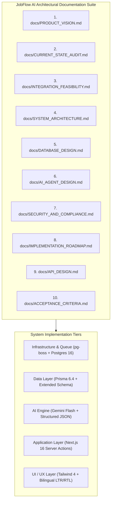
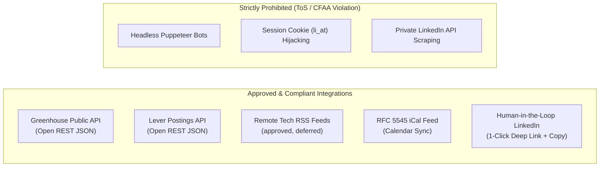

# JobFlow AI — Master Product Architecture & Implementation Plan
**Document ID:** `docs/IMPLEMENTATION_PLAN.md`  
**Status:** Approved Master Blueprint — execution governed by `docs/EXECUTION_STRATEGY.md` v3.0  
**Version:** 3.0 (review alignment)  
**Target Project:** `F:\AI Job Networking Assistant\ai_job_assistant`  
**Architect:** Principal Software Architect & AI Product Manager  

> **Authority note (2026-10-31 review).** This document describes the product architecture and capability map. The **binding execution order, schema scope, and acceptance gates** are defined in [`docs/EXECUTION_STRATEGY.md`](EXECUTION_STRATEGY.md) v3.0 (milestones M0A–M5). Where this plan and the strategy differ, the strategy wins. In particular: no `prisma db push`, no speculative domain models, and pg-boss is conditional on a long-lived worker host.

---

## 1. Executive Master Blueprint

**JobFlow AI** is transitioning from a traditional, reactive job-search CRM into an **autonomous, proactive AI-powered career agent**. The system continuously monitors external job boards, evaluates candidate compatibility with deep explainability, discovers relevant decision-makers, crafts culturally nuanced outreach, and drives applications through a structured relationship pipeline.

This master implementation plan establishes the architectural standards, security policies, database extensions, and phased development roadmaps governing the project.

---

## 2. Planning Document Index & Cross-References

| Document | Path | Core Scope & Architectural Contribution |
| :--- | :--- | :--- |
| **Product Vision** | [`docs/PRODUCT_VISION.md`](file:///f:/AI%20Job%20Networking%20Assistant/ai_job_assistant/docs/PRODUCT_VISION.md) | Product vision, regional personas (Egypt, MENA, Remote), 8-stage agentic workflow, and non-goals. |
| **Current State Audit** | [`docs/CURRENT_STATE_AUDIT.md`](file:///f:/AI%20Job%20Networking%20Assistant/ai_job_assistant/docs/CURRENT_STATE_AUDIT.md) | Audit of active models, existing working features, technical debt, and refactoring targets. |
| **Integration Feasibility** | [`docs/INTEGRATION_FEASIBILITY.md`](file:///f:/AI%20Job%20Networking%20Assistant/ai_job_assistant/docs/INTEGRATION_FEASIBILITY.md) | Analysis of LinkedIn restrictions, CFAA risks, ATS APIs (Greenhouse/Lever), and HITL dispatch. |
| **System Architecture** | [`docs/SYSTEM_ARCHITECTURE.md`](file:///f:/AI%20Job%20Networking%20Assistant/ai_job_assistant/docs/SYSTEM_ARCHITECTURE.md) | Next.js 16 Clean Architecture, `pg-boss` queue design, pluggable discovery adapters, and i18n RTL. |
| **Database Design** | [`docs/DATABASE_DESIGN.md`](file:///f:/AI%20Job%20Networking%20Assistant/ai_job_assistant/docs/DATABASE_DESIGN.md) | JIT MVP schema (`UserProfile`, `UserSkill`, `JobSource`, `DiscoveredJob`), extension of existing match/contact tables, and migration-first workflow. |
| **AI Agent Design** | [`docs/AI_AGENT_DESIGN.md`](file:///f:/AI%20Job%20Networking%20Assistant/ai_job_assistant/docs/AI_AGENT_DESIGN.md) | Sense-Plan-Act-Learn loop, Zod structured outputs, prompt injection defenses, and Egyptian dialect synthesis. |
| **Security & Compliance** | [`docs/SECURITY_AND_COMPLIANCE.md`](file:///f:/AI%20Job%20Networking%20Assistant/ai_job_assistant/docs/SECURITY_AND_COMPLIANCE.md) | SSRF defense engine, DOMPurify XSS mitigation, tenant isolation, and anti-ban protocols. |
| **Implementation Roadmap** | [`docs/IMPLEMENTATION_ROADMAP.md`](file:///f:/AI%20Job%20Networking%20Assistant/ai_job_assistant/docs/IMPLEMENTATION_ROADMAP.md) | Capability map (Phases 0–8), mapped to the binding M0A–M5 milestone plan. |
| **API Design** | [`docs/API_DESIGN.md`](file:///f:/AI%20Job%20Networking%20Assistant/ai_job_assistant/docs/API_DESIGN.md) | Typed Server Actions for profile, discovery, matching, and outreach, plus REST webhooks and ICS feed. |
| **Acceptance Criteria** | [`docs/ACCEPTANCE_CRITERIA.md`](file:///f:/AI%20Job%20Networking%20Assistant/ai_job_assistant/docs/ACCEPTANCE_CRITERIA.md) | Testable checklists, performance SLAs (<250ms render), security gates, and i18n standards. |
| **Execution Strategy** | [`docs/EXECUTION_STRATEGY.md`](file:///f:/AI%20Job%20Networking%20Assistant/ai_job_assistant/docs/EXECUTION_STRATEGY.md) | Binding v3.0 review: M0A–M5 milestones, JIT schema, pg-boss feasibility, matching evaluation, and first-milestone spec. |

---

## 3. High-Level System Architecture Summary

1. **Client & Presentation**:
   - Modern Next.js 16 App Router with React 19.
   - Tailwind CSS 4 with logical directional properties (`ms-*`, `me-*`, `ps-*`, `pe-*`) for native English (LTR) and Egyptian Arabic (RTL) rendering.
   - Instant omni-search via `Ctrl+K` Global Command Palette.
2. **Asynchronous Background Processing**:
   - PostgreSQL-native queue (`pg-boss`) on the existing PostgreSQL instance. It requires a **long-lived Node.js worker** and Node `>=22.12`; it is not wired into the Next.js request path.
   - Adoption is conditional on the production host (see `docs/EXECUTION_STRATEGY.md` §3). If no worker host exists, discovery runs as manual sync plus an external scheduler.
3. **AI Cognitive Engine**:
   - Google Gemini API (`gemini-flash-latest`) via REST with JSON Schema enforcement and Zod runtime validation.
   - Dedicated prompt templates for Egyptian Arabic tech colloquialisms (`AR_EG`), Modern Standard Arabic (`AR_MSA`), and concise Silicon Valley English (`EN`).
4. **Data Layer**:
   - Prisma ORM 6.4.1 targeting PostgreSQL 16.
   - Strict tenant scoping (`where: { userId }`) across all entities.

---

## 4. External Integrations Summary

- **Greenhouse Public Board API**: Free, unauthenticated REST endpoint (`https://boards-api.greenhouse.io/v1/boards/{board_token}/jobs`). Ingests title, department, location, and full job description.
- **Lever Postings API**: Free, unauthenticated REST endpoint (`https://api.lever.co/v0/postings/{company}?mode=json`).
- **Human-in-the-Loop LinkedIn Outreach**: 100% compliant. Copies AI-generated message to the clipboard and opens the recipient's LinkedIn profile in a new tab. Protects user accounts from bans while keeping execution time under 5 seconds per contact.

---

## 5. Phased Roadmap Summary

| Phase | Title | Core Objective | Key Deliverables |
| :---: | :--- | :--- | :--- |
| **0** | **Security & Migration Baseline** | Harden the existing URL importer; establish migration discipline | `safe-fetch.ts` hardening, CI, migration drift gate, `.env.example`; **no schema push, no domain models** |
| **1** | **Career Profile** | Structured profile and skills (resume versions deferred) | `UserProfile`, `UserSkill`, profile UI |
| **2** | **Job Discovery** | ATS polling, normalization, dedup, source health | Greenhouse/Lever adapters, `JobSource`, `DiscoveredJob`, triage inbox |
| **3** | **Explainable Matching** | Server-computed 0–100 score with semantic evidence | Extended `OpportunityMatchAnalysis`, gold-set evaluation, score UI |
| **4** | **Contact CRM** | Permitted contact discovery, manual entry, relationship stages | Contact source fields, linker widget, manual add flow |
| **5** | **Outreach Studio** | Cultural synthesis (`AR_EG`, `EN`, `MSA`) | Dialect prompts, revision history |
| **6** | **HITL Dispatch** | Reuse `MessageDraft` + `OutreachActivity` + `FollowUpTask` | Copy & open, mark sent, follow-up creation |
| **7** | **Cadence Engine** | Proactive daily actions, stale contact scan | Daily Next Best Action cards, stale scanner |
| **8** | **Analytics & Hardening** | Velocity metrics, rejection analysis, ICS sync | Stage velocity chart, ICS feed, backups |

> Phases are a capability map. Execution follows the smaller M0A–M5 plan in `docs/EXECUTION_STRATEGY.md` §10; several phases above are combined or deferred there.

---

## 6. Critical Security & Compliance Policies

1. **Zero-Trust Network Ingestion (SSRF Protection)**: All URLs fetched by the system must pass URL validation, DNS resolution checks against private/loopback/link-local/metadata ranges, **IP pinning to prevent DNS rebinding**, redirect re-validation, and a **streamed body-size cap**. IPv4-mapped IPv6 and NAT64 forms are rejected. See `docs/SECURITY_AND_COMPLIANCE.md` §2.
2. **Zero-Credential Hijacking**: No LinkedIn credentials, passwords, or session cookies are ever requested, stored, or automated.
3. **Indirect Prompt Injection Defense**: Untrusted job postings are strictly isolated within `<untrusted_job_description>` XML tags with system-level instruction anchoring.
4. **Tenant Isolation**: Every Server Action validates user session via `requireAuth()` and scopes database queries by `userId`.

---

## 7. Approval & Implementation Readiness

All foundational planning documents have been reviewed against the codebase and reconciled with [`docs/EXECUTION_STRATEGY.md`](EXECUTION_STRATEGY.md) v3.0. The architecture is ready for phase-by-phase execution upon user confirmation, starting with **M0A — Security & Migration Baseline**.

**Known baseline corrections applied in the review:** no `prisma db push`; no speculative models; pg-boss 12.38.0 API and Node `>=22.12` requirement; verified ATS board tokens; server-computed match scores; LinkedIn navigation-only boundary; existing uncommitted queue/SSRF work treated as a partially implemented spike.

