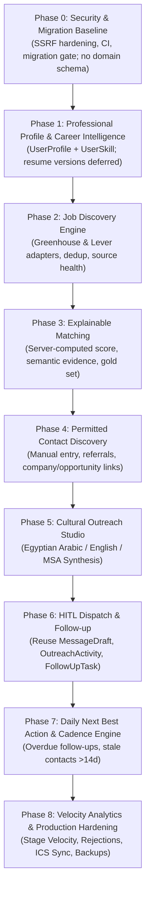

# JobFlow AI — Master Implementation Roadmap
**Document ID:** `docs/IMPLEMENTATION_ROADMAP.md`  
**Status:** Approved Engineering Plan — capability map aligned to `docs/EXECUTION_STRATEGY.md` v3.0  
**Author:** Principal Software Architect & AI Product Manager  

> **Execution authority.** This roadmap is a capability map. The binding delivery order and scope are the **M0A–M5 milestones** in [`docs/EXECUTION_STRATEGY.md`](EXECUTION_STRATEGY.md) §10. The 9 phases below are retained for product context; where they conflict with v3.0, v3.0 wins.

---

## 1. Roadmap Overview & Timeline

The transformation of JobFlow AI into an autonomous job discovery and networking agent is organized as **9 capability phases (0–8)**. They are delivered through the smaller, independently testable milestones M0A–M5.

### Milestone mapping

| Capability phase | Delivered in |
|---|---|
| Phase 0 | M0A (security/migration baseline); M0B (queue spike, conditional) |
| Phase 1 | M1 |
| Phase 2 | M2 |
| Phase 3 | M3 |
| Phases 4–6 | M4 |
| Phases 7–8 | M5 (plus later increments) |

---

## 2. Phase-by-Phase Technical Specifications

### Phase 0: Security & Migration Baseline
- **Objective**: Harden the one network-ingestion path that already has a consumer (the job-URL importer), and establish migration/CI discipline. **No business domain models** are added in this phase.
- **Deliverables**:
  - `src/lib/security/safe-fetch.ts`: DNS pinning, streamed body cap, IPv4-mapped IPv6/NAT64 rejection, content-type allowlist, redirect re-validation.
  - `tests/security/safe-fetch.test.ts`: rebinding, chunked-oversize, IPv6-mapped, redirect-to-private, timeout cases.
  - CI workflow: typecheck, tests, lint baseline, `prisma validate`, migration drift gate.
  - `.env.example` tracked and complete; `scripts/check-migrations.mjs`.
  - Queue spike (`src/server/queue/boss.ts`, `src/server/worker/index.ts`) is **time-boxed and not production-wired**; it becomes M0B only when M2 is next.
- **Complexity**: Medium (1–2 days) | **Prerequisites**: None.

### Phase 1: Professional Profile & Career Intelligence
- **Objective**: Upgrade the single-text `cvSummary` into a structured career profile with categorized skills. Multi-version resumes are **deferred** until a storage backend is chosen.
- **Deliverables**:
  - `app/(dashboard)/profile/page.tsx`: Career profile management center.
  - `src/components/profile/skill-matrix.tsx`: Categorized skill selector (Frontend, Backend, Tools) with proficiency ratings.
  - Server actions in `src/server/actions/profile.ts`.
  - `UserProfile` and `UserSkill` migration; backfill fallback from `Settings`.
- **Complexity**: Medium (2–3 days) | **Prerequisites**: Phase 0 (M0A).

### Phase 2: Autonomous Job Discovery Engine
- **Objective**: Discover jobs from public Greenhouse/Lever board APIs with normalization, deduplication, delisting, and source health.
- **Deliverables**:
  - `src/server/services/discovery/greenhouse-adapter.ts`: Greenhouse public board parser.
  - `src/server/services/discovery/lever-adapter.ts`: Lever JSON postings parser.
  - `src/server/services/discovery/manager.ts`: normalization, fingerprint dedup, delisting, health state.
  - `JobSource` + `DiscoveredJob` migration; unique `(userId, sourceId, externalId)`.
  - `app/(dashboard)/discovered/page.tsx`: Triage inbox with "Convert to Opportunity" or "Dismiss".
  - Live probe on add/edit; 6-hour configurable sync; circuit breaker.
- **Complexity**: High (4–6 days) | **Prerequisites**: Phase 0 (M0B host decision), Phase 1.

### Phase 3: Explainable Matching & Gap Diagnosis
- **Objective**: Evaluate every discovered job against the candidate profile with a **server-computed** score and LLM-provided semantic evidence.
- **Deliverables**:
  - `src/lib/ai/cv-matcher.ts`: Zod-validated semantic evidence; no LLM-owned final score.
  - Deterministic `techScore`, `seniorityScore`, `locationScore`; weighted final score with `scoringVersion` and `inputHash`.
  - Extended `OpportunityMatchAnalysis`; `ExperienceLevel.LEAD` additive migration.
  - Gold-set evaluation (`tests/fixtures/matching-gold-v1.json`); Precision@5 gate.
  - `src/components/opportunities/ats-score-badge.tsx` and `skill-gap-modal.tsx`.
- **Complexity**: Medium–High (3–4 days) | **Prerequisites**: Phase 1, Phase 2.

### Phase 4: Permitted Contact Discovery & Contact CRM
- **Objective**: Link recruiters, hiring managers, and tech leads to target companies and opportunities using **manual entry, referrals, and user-assisted search links only**. LinkedIn is navigation, not a data source.
- **Deliverables**:
  - `src/components/contacts/opportunity-contact-linker.tsx`: Multi-select contact association widget.
  - `Contact.sourceType` (`MANUAL`, `REFERRAL`, `COMPANY_PAGE`, `GITHUB`, `COMMUNITY`, `OTHER`) and `lastVerifiedAt`.
  - Manual add flow with prefilled company/role; dedup by normalized profile URL.
  - Suggested-title search deep links; the user copies the profile URL back.
  - Relationship stage tracker (existing enum, no new stages).
- **Complexity**: Low–Medium | **Prerequisites**: Phase 1, Phase 3.

### Phase 5: AI Outreach Studio & Cultural Synthesis
- **Objective**: Synthesize highly tailored outreach messages supporting Egyptian Arabic (`AR_EG`), English (`EN`), and Modern Standard Arabic (`MSA`), using only user-provided facts.
- **Deliverables**:
  - Enhanced `src/lib/ai/message-generator.ts` with Egyptian tech dialect prompts.
  - Tone options: `CONCISE_DIRECT`, `FRIENDLY_PROFESSIONAL`, `FORMAL`.
  - Zod validation of generated drafts; no LinkedIn data in the prompt.
  - Version history comparison in `src/components/messages/revision-history.tsx`.
- **Complexity**: Medium | **Prerequisites**: Phase 1, Phase 4.

### Phase 6: Human-in-the-Loop (HITL) Dispatch & Follow-up
- **Objective**: Reuse `MessageDraft`, `OutreachActivity`, and `FollowUpTask` for a daily outbox with rapid copy/open and manual send confirmation. **No separate `OutreachQueue` table.**
- **Deliverables**:
  - `app/(dashboard)/outreach/page.tsx`: Approved drafts due for manual send.
  - `src/components/outreach/dispatch-card.tsx`: "Copy Message & Open Profile" and "Mark as Sent".
  - On mark-sent: log `OutreachActivity`, set `MessageDraft.status = SENT`, create exactly one `FollowUpTask` (+3 days).
  - Clipboard-denied fallback with selectable text.
- **Complexity**: Medium | **Prerequisites**: Phase 4, Phase 5.

### Phase 7: Daily Next Best Action & Cadence Engine
- **Objective**: Proactively direct the user's focus each day toward high-impact actions.
- **Deliverables**:
  - Background worker evaluating stale contacts (>14 days without interaction).
  - Overdue follow-up prioritization.
  - `src/components/dashboard/next-best-action.tsx`: Redesigned action planner with 1-click execution pills.
- **Complexity**: Medium | **Prerequisites**: Phase 6.

### Phase 8: Advanced Velocity Analytics, Export & Hardening
- **Objective**: Measure pipeline speed, analyze rejections to uncover skill gaps, and provide data portability.
- **Deliverables**:
  - `app/(dashboard)/analytics/page.tsx`: Recharts visualizations for Stage Velocity and Rejection Post-Mortems.
  - ICS calendar export feed for interview schedules and follow-up deadlines.
  - Full JSON/CSV workspace backup and restore server actions.
  - End-to-end integration test suites.
- **Complexity**: Medium | **Prerequisites**: Phase 0 through Phase 7.

