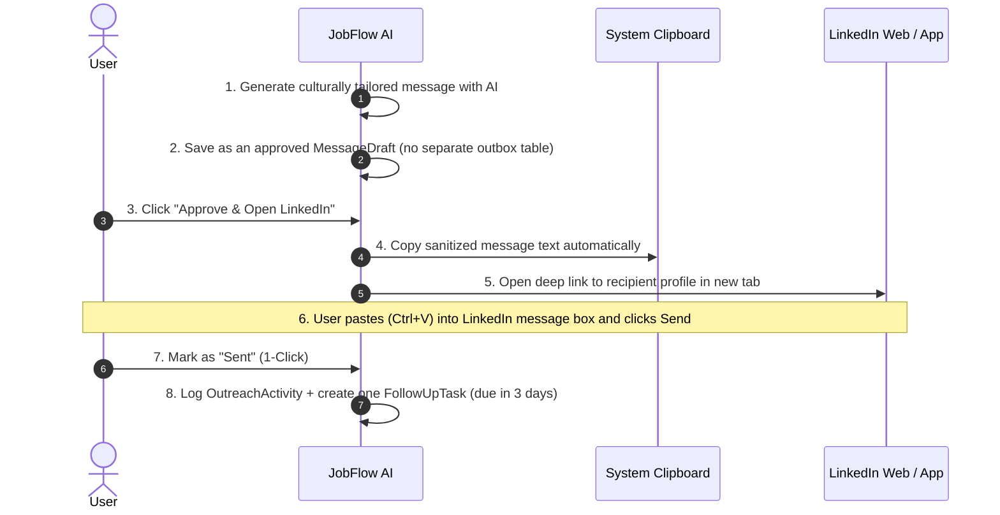
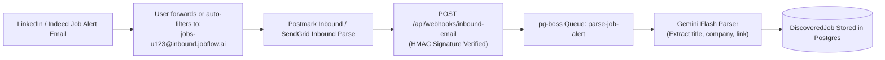

# JobFlow AI — Integration Feasibility & Legal Compliance Analysis
**Document ID:** `docs/INTEGRATION_FEASIBILITY.md`  
**Status:** Approved Architectural Assessment — aligned to `docs/EXECUTION_STRATEGY.md` v3.0  
**Version:** 3.0 (live-verified 2026-10-31)  
**Author:** Principal Software Architect & Security Specialist  

> **Verification note.** ATS endpoints and board tokens below were probed on **2026-10-31**. Tokens are configuration, not constants: every add/edit must run a live probe, and scheduled health checks must detect drift. Earlier revisions listed dead tokens (`paymob`, `netflix`, `courier`, `eventbrite`); those returned 404 and have been removed from the approved examples.

---

## 1. Executive Feasibility Matrix

To ensure stability, long-term viability, and total protection of user accounts, every third-party integration is evaluated across **Technical Viability**, **Legal & Terms-of-Service (ToS) Compliance**, **Account Ban Risk**, and **Operational Cost**.

```mermaid
quadrantChart
    title Integration Feasibility & Risk Quadrant
    x-axis Low Technical Complexity --> High Technical Complexity
    y-axis Low Risk / Compliant --> High Risk / Non-Compliant
    quadrant-1 Unviable & Dangerous
    quadrant-2 Compliant but Complex
    quadrant-3 Fast & Compliant (Core MVP)
    quadrant-4 Technically Hard & High Risk
    "Greenhouse Board API": [0.15, 0.10]
    "Lever Job Postings API": [0.18, 0.12]
    "Gemini Structured Extraction": [0.25, 0.08]
    "ICS Calendar Sync": [0.20, 0.05]
    "HITL LinkedIn One-Click Dispatch": [0.30, 0.15]
    "Inbound Email Parsing (Postmark/SES)": [0.65, 0.20]
    "Ashby / Workable Scraper": [0.55, 0.35]
    "Unofficial LinkedIn REST / li_at Hijack": [0.85, 0.95]
    "Headless Browser Auto-Connect Bot": [0.90, 0.98]
```

| Candidate Integration | Technical Feasibility | Legal / ToS Compliance | Ban Risk | Decision |
| :--- | :--- | :--- | :--- | :--- |
| **Greenhouse Public Board API** | **100% (REST JSON)** | 100% (Public Open Endpoint) | Zero | **Approved (Core Engine)** |
| **Lever Postings API** | **100% (REST JSON)** | 100% (Public Open Endpoint) | Zero | **Approved (Core Engine)** |
| **RSS / Atom Job Feeds** | **100% (XML Parsing)** | 100% (Public Feeds) | Zero | **Approved (deferred beyond MVP)** |
| **Human-in-the-Loop (HITL) LinkedIn** | **100% (Deep Link / Clipboard)** | 100% (Standard User Browsing) | Zero | **Approved (Core Outreach)** |
| **Inbound Job Alert Email Webhooks** | **100% (Postmark / SendGrid)** | 100% (User forwards own alerts) | Zero | **Approved (deferred beyond MVP)** |
| **Official LinkedIn Public OAuth** | **Limited (Identity Only)** | 100% Compliant | Zero | **Not used (identity only; no messaging)** |
| **Headless Puppeteer LinkedIn Bot** | Fragile (Breaks on DOM updates) | **Severe Violation (Section 8.2)** | **Extreme** | **REJECTED (Illegal / High Ban)** |
| **Session Cookie (`li_at`) Automation** | Fragile (Frequent invalidations) | **Severe Violation (CFAA risks)** | **Extreme** | **REJECTED (Dangerous)** |

---

## 2. In-Depth LinkedIn Integration Evaluation

### 2.1 The Official LinkedIn Developer Program Reality
LinkedIn maintains one of the most restrictive developer ecosystems in the industry:
- **Available Public Scopes**: When registering an application on the LinkedIn Developer Portal, standard developers are restricted to `openid`, `profile`, `email`, and `w_member_social` (posting updates to the user's personal feed).
- **Enterprise-Restricted Scopes**: Scopes governing messaging (`messages:write`, `conversations:read`), connection invitations (`invitations:write`), and candidate search (`people-search`) are strictly reserved for approved enterprise partners under the **LinkedIn Talent Solutions (LTS)** and **Recruiter System Connect (RSC)** partner programs.
- **Enterprise Requirement**: Securing RSC access requires an enterprise partnership contract, annual minimum spend commitments, and enterprise ATS status. It is inaccessible for personal or small-team productivity applications.

### 2.2 Unofficial Automation, Cookie Hijacking & Scraping Risks
Multiple commercial tools (e.g. Phantombuster, Waalaxy, Dripify) operate by obtaining the user's session cookie (`li_at`) or running headless Chrome instances using Puppeteer/Playwright. We have audited this approach and formally determined it to be **unacceptable for JobFlow AI** for the following architectural and legal reasons:

1. **LinkedIn User Agreement (Section 8.2)**:
   Explicitly prohibits using bots, scrapers, crawlers, or automating actions. Automated activity violates the agreement and gives LinkedIn grounds to terminate accounts.
2. **Behavioral Bot Detection & Machine Learning Heuristics**:
   LinkedIn employs advanced bot detection (PerimeterX/Human Security, behavioral cadence tracking, mouse movement entropy, TCP fingerprinting). Unnatural request spikes or headless browser signatures trigger automated security challenges (CAPTCHA, phone verification, and immediate 14-day or permanent account bans).
3. **Computer Fraud and Abuse Act (CFAA) & Credential Vulnerabilities**:
   Storing a user's plaintext `li_at` cookie on our servers creates extreme security liability. If the server or database is compromised, the attacker acquires total hijack access to the user's professional identity.
4. **HiQ Labs v. LinkedIn Precedents**:
   While public data indexing without login was contested in US Ninth Circuit courts, accessing authenticated pages via automated scripts after explicit cease-and-desist constitutes breach of contract and potential CFAA liability.

### 2.3 The Compliant Solution: The Human-in-the-Loop (HITL) Dispatch Engine
To deliver seamless, automated productivity without risking user accounts, JobFlow AI implements a **Human-in-the-Loop (HITL) Assistant Workflow**:



- **Zero Ban Risk**: The request originates from the user's legitimate browser session, IP, and hardware with standard user behavioral entropy.
- **Speed & Frictionless UX**: The user spends under 5 seconds per contact: click "Dispatch" -> paste in tab -> click "Mark Sent" -> follow-up is scheduled.
- **Total Compliance**: Zero ToS violations, zero credential storage, zero cookie sniffing.
- **Data boundary**: The app never fetches LinkedIn profile HTML, search results, connections, or messages. The profile URL is only a navigation target. See `docs/EXECUTION_STRATEGY.md` §6.

---

## 3. Applicant Tracking System (ATS) Public Job Ingestion

Rather than fragile web scraping of protected portals, top tech scale-ups host public career portals on structured ATS platforms with **open, unauthenticated JSON endpoints**.

### 3.1 Greenhouse Public Board API
- **Endpoint**: `GET https://boards-api.greenhouse.io/v1/boards/{board_token}/jobs?content=true`
- **Authentication**: None required. Fully public.
- **Rate Limit**: Generous; still pace requests and honor `Retry-After`.
- **Data Extracted**:
  - `id`: Unique external posting ID (numeric).
  - `title`: Job title.
  - `departments`: Engineering, Product, Design, etc.
  - `offices` / `location`: City, country, or "Remote".
  - `content`: HTML-escaped HTML job description (decode once, then sanitize).
  - `updated_at` / `first_published`: ISO timestamps with offsets.
  - `absolute_url`: Canonical public URL.
  - `company_name`: Display name.
- **Heavy boards**: For large boards, fetch the list with `content=false`, then fetch only new/changed jobs via `GET /v1/boards/{token}/jobs/{id}` (verified 200).
- **Verified board tokens (2026-10-31)**:

| Token | Status | Jobs |
|---|---|---|
| `careem` | 200 | 11 |
| `stripe` | 200 | 746 |
| `figma` | 200 | 140 |
| `airbnb` | 200 | 202 |
| `gitlab` | 200 | 238 |
| `instacart` | 200 | 96 |
| `datadog` | 200 | 397 |
| `paymob` | **404** | — |

### 3.2 Lever Postings API
- **Endpoint**: `GET https://api.lever.co/v0/postings/{company}?mode=json`
- **Authentication**: None required. Fully public.
- **Rate Limit**: Unauthenticated public endpoint; standard caching headers provided.
- **Data Extracted**:
  - `id`: UUID job ID.
  - `text`: Job title.
  - `categories`: Commitment, Department, Location, Team, AllLocations.
  - `workplaceType`: Top-level `onsite` / `hybrid` / `remote` (preferred over regex).
  - `descriptionPlain` / `additionalPlain`: Plain-text description and requirements.
  - `description`: HTML variant.
  - `createdAt`: Epoch milliseconds.
  - `hostedUrl` / `applyUrl`: Public and apply URLs.
  - `salaryRange`: Optional `{ min, max, currency, interval }`.
- **Verified board tokens (2026-10-31)**:

| Token | Status | Jobs |
|---|---|---|
| `leverdemo` | 200 | 10 |
| `spotify` | 200 | 89 |
| `mistral` | 200 | 0 |
| `netflix` | **404** | — |
| `courier` | **404** | — |
| `eventbrite` | **404** | — |

### 3.3 Source probe, normalization, and health

**Probe on add/edit**
- Timeout 10 s; expect JSON with the documented shape.
- `404` → `INVALID` token (do not retry; ask the user to fix it).
- `401/403` → `BLOCKED`; `429` → `RATE_LIMITED` (honor `Retry-After`); `5xx`/timeout → `TRANSIENT`.
- A `200` with zero jobs is valid (the board may be empty).

**Normalization**
- `externalId` is namespaced: `GREENHOUSE:{token}:{id}` or `LEVER:{token}:{id}`.
- `companyKey`: lowercase, trim, strip legal suffixes, collapse punctuation.
- `titleKey`: lowercase, collapse whitespace, normalize `sr`/`senior`, `jr`/`junior`, `front-end`/`frontend`.
- `workArrangement`: prefer structured `workplaceType`; fallback to location/title regex; default `UNKNOWN`.
- `descriptionText`: decode HTML entities, sanitize, strip scripts/iframes/handlers, cap at 50k chars.
- `descriptionHash`: SHA-256 of normalized text.
- `fingerprint`: SHA-256 of `companyKey|titleKey|locationKey|workArrangement|employmentType` (do **not** include description).
- Dates: Greenhouse ISO strings; Lever epoch ms.

**Deduplication**
- Unique `(userId, sourceId, externalId)`.
- Cross-source fingerprint match within 30 days → `duplicateOfId`, one canonical row.
- Content hash change updates the description but preserves user triage state.
- Full-snapshot sync marks absent jobs `isActive = false` / `closedAt`; never on a failed/partial fetch.

**Health**
- Track `lastCheckedAt`, `lastSuccessAt`, `consecutiveFailures`, `lastErrorCode`.
- After 5 consecutive transient failures → `ERROR`; back off 6h → 12h → 24h.
- UI badges: `ACTIVE`, `DEGRADED`, `ERROR`, `INVALID`, `PAUSED`.

### 3.4 Remote Tech Aggregators (RSS / Public JSON Feeds) — deferred
- **WeWorkRemotely RSS**: `https://weworkremotely.com/categories/remote-programming-jobs.rss`.
- **RemoteOK API**: `https://remoteok.com/api`.
- These are **out of scope for the MVP**; they need their own adapter contract, rate-limit review, and dedup fingerprints.

---

## 4. Email Parsing & Alert Ingestion — deferred beyond MVP

Users frequently receive daily job alert emails from LinkedIn, Indeed, Glassdoor, and Bayt. This is a useful later integration, but it is **not part of the MVP** because it adds inbound-email infrastructure, HMAC verification, and another parser to validate.

### Architecture (future)


1. **Dedicated User Inbound Address**: Each user is assigned an alias: `jobs-{userHandle}@inbound.jobflow.ai`.
2. **Auto-Forwarding Rule**: The user creates a simple Gmail/Outlook filter: `"from:jobalerts-noreply@linkedin.com -> Forward to jobs-user@inbound.jobflow.ai"`.
3. **Webhook Ingestion**: Postmark or AWS SES receives the MIME email, parses the payload into structured JSON (`Subject`, `HtmlBody`, `TextBody`), and POSTs to our API endpoint.
4. **AI Link & Detail Extraction**: Google Gemini extracts the discrete job openings from the digest email and creates records in `discovered_jobs` for user review.

**Deferral criteria:** add this only after the Greenhouse/Lever loop is stable, and only with a signed-webhook test suite and an allowlist of sender domains.

---

## 5. Security & Rate Limiting Guardrails

1. **Third-Party Rate Limits**:
   - Outgoing requests to Greenhouse and Lever are paced at maximum **1 request every 500 ms** per host, with jitter and `If-None-Match` / `If-Modified-Since` where supported.
   - Honor `429` + `Retry-After`; do not count it as a hard failure.
2. **SSRF and response safety**:
   - All non-ATS URL fetching goes through `safeFetch`: DNS pinning, private/loopback/link-local/metadata blocking, redirect re-validation, content-type allowlist, and a streamed body-size cap.
   - ATS adapters call fixed, allowlisted hosts only; they do not accept arbitrary URLs.
3. **AI Quota Protection**:
   - Google Gemini API requests are guarded by an in-memory sliding-window rate limiter (`10 requests / 60 seconds` per user), with a persistent daily quota in PostgreSQL (`100 LLM calls / day`).
   - Cache by input hash so the same job/profile pair is not re-billed.
4. **Sanitization of Inbound Feeds**:
   - All external HTML descriptions are decoded once and sanitized with strict DOMPurify rules before storage/presentation to eliminate XSS vectors in job descriptions.
   - Never render raw ATS HTML with `dangerouslySetInnerHTML`.

