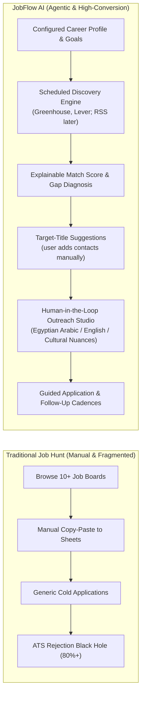
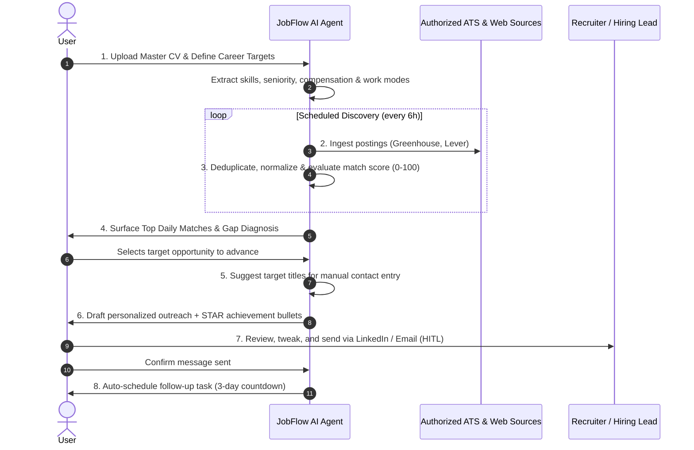

# JobFlow AI — Product Vision & Strategic Charter
**Document ID:** `docs/PRODUCT_VISION.md`  
**Status:** Approved Architectural Blueprint  
**Version:** 2.0  

---

## 1. Executive Vision

**JobFlow AI** is an intelligent personal career agent and networking command center designed for software engineers and knowledge workers. It shifts the paradigm from passive, reactive CRUD job trackers (spreadsheets, basic applicant trackers) to an **agentic, proactive AI co-pilot** that works in the background to discover high-fit opportunities, suggest who to contact, craft culturally tailored outreach, and systematically advance applications through the pipeline.

---

## 2. Core User Personas & Regional Context

### Persona 1: Senior Frontend / Full-Stack Engineer (Middle East / MENA)
- **Profile:** Software engineer in Egypt with 4–7 years experience targeting Senior Frontend (`React`, `Next.js`, `TypeScript`) roles.
- **Pain Points:** 
  - Submitting hundreds of applications into global job portals without responses.
  - High fluctuation in local vs. remote international compensation packages (EGP payroll vs. USD offshore contractor).
  - Lack of warm introductions or referrals into competitive companies (Careem, Instabug, Paymob, Noon, remote scaleups).
  - Difficulty articulating achievements in tailored English and professional Egyptian Arabic dialect for local tech leads.
- **JobFlow AI Value:** Surfaces verified high-match roles from direct ATS boards, drafts culturally nuanced warm outreach for Cairo-based engineering managers, and tracks compensation in both EGP and USD.

### Persona 2: Global Remote Software Developer
- **Profile:** Engineer seeking remote-first international companies across Europe and North America.
- **Pain Points:**
  - Filtering out spam and ghost jobs on broad aggregators.
  - Timezone misalignment and strict regional compliance.
  - Keeping track of dozens of interview stages and recruiter conversations simultaneously.
- **JobFlow AI Value:** Monitors clean ATS feeds (Greenhouse, Lever), extracts structured compensation and timezone bounds, and enforces automated 3-day and 7-day follow-up cadences.

---

## 3. The 8-Stage Autonomous User Experience

1. **Configure Profile Once**: User uploads master CV (PDF/Markdown) and sets target roles (`Senior Frontend Engineer`), tech stack (`React`, `Next.js`, `TypeScript`), preferred work mode (`Remote`, `Hybrid`), target geographies (`Egypt`, `MENA`, `US/EU Remote`), and salary thresholds.
2. **Scheduled Discovery**: The worker monitors authorized public ATS endpoints (Greenhouse, Lever) every 6 hours, or the user triggers a sync manually. RSS and email alerts are later integrations.
3. **Deep Compatibility & Gap Analysis**: Calculates an explainable 0–100% compatibility score on the server. Categorizes matched vs missing skills, highlighting what to emphasize in interviews and CV bullets.
4. **Professional & Recruiter Discovery**: Suggests target titles (engineering manager, tech recruiter, tech lead) and generates a search link. The user adds the contact manually from a permitted source; the app does not scrape LinkedIn.
5. **Culturally Nuanced Outreach Synthesis**: Drafts personalized icebreakers, referral requests, and recruiter inquiries with tone selection (`CONCISE_DIRECT`, `FRIENDLY_PROFESSIONAL`, `FORMAL`) and dialect (`EGYPTIAN_ARABIC`, `ENGLISH`, `MSA`).
6. **Guided Application Assistant**: Compares the specific job description against the candidate's CV version, generates custom STAR bullets, and drafts a 2-paragraph cover letter pitch.
7. **Human-in-the-Loop (HITL) Execution**: Provides a high-speed **"Copy & Open Profile"** workflow that respects third-party platform terms and eliminates account ban risks.
8. **Automated Relationship & Follow-Up Cadence**: Automatically generates follow-up tasks, notifies users when contacts become stale (>14 days), and measures pipeline velocity through time-in-stage analytics.

---

## 4. Architectural Shift: From CRUD Dashboard to Agentic Partner

| Dimension | Legacy Job CRM | JobFlow AI Agentic Platform |
| :--- | :--- | :--- |
| **Data Ingestion** | Manual form entry for every single job posting. | Scheduled Greenhouse/Lever sync + 1-click AI text/URL importer. |
| **Matching** | User manually reads descriptions and guesses fit. | Deterministic component scoring + bounded semantic LLM evidence, server-computed final score. |
| **Outreach** | Static copy-paste email templates. | Dynamic LLM synthesis conditioned on recipient role, company signals, and past interactions. |
| **Execution** | Passive table rows with no urgency. | Daily Next Best Action planner prioritizing overdue tasks and relationship decay. |
| **Safety & Compliance** | Risky third-party browser extensions risking LinkedIn bans. | Manual copy/open/send flow, no LinkedIn ingestion, no credential storage. |
| **Platform Language** | English-only interfaces with LTR constraints. | First-class native bilingual support (English LTR & Arabic RTL) with Egyptian dialect generation. |

---

## 5. Strategic Guardrails & Non-Goals

1. **Zero Credential Hijacking**: JobFlow AI will **never** request, store, or automate LinkedIn login credentials, session cookies (`li_at`), or headless browser stealth automation.
2. **No Unsupervised Autonomous Sending**: The AI agent **will never send cold messages or submit applications autonomously** without human approval. All outreach and application submissions require user confirmation.
3. **No Phantom Integrations**: The system will explicitly disclose the boundary between official direct APIs (e.g. Greenhouse public board, Google Calendar ICS) and guided user-driven actions (e.g. LinkedIn message transmission).

