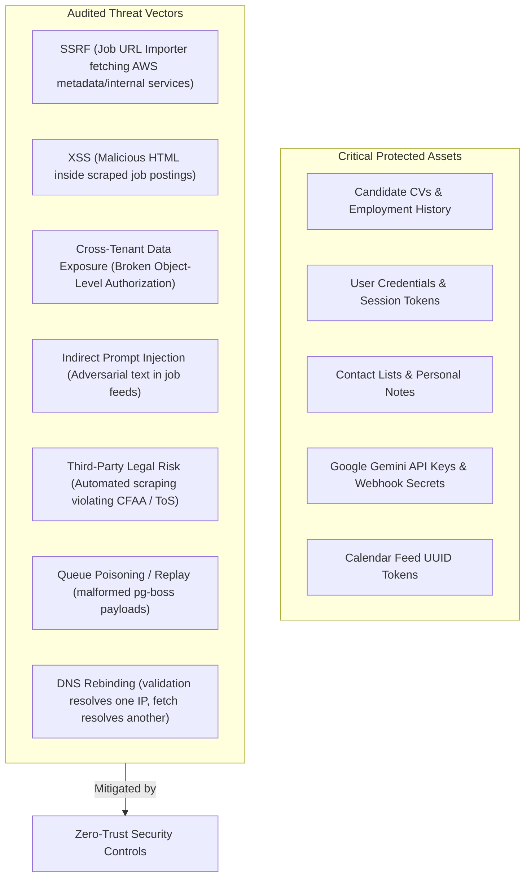
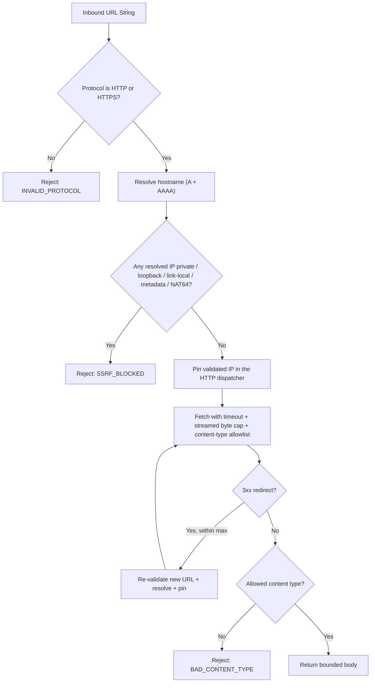

# JobFlow AI — Security Architecture & Legal Compliance Charter
**Document ID:** `docs/SECURITY_AND_COMPLIANCE.md`  
**Status:** Approved Security Specification — aligned to `docs/EXECUTION_STRATEGY.md` v3.0  
**Version:** 3.0  
**Author:** Security Specialist & Principal Systems Architect  

---

## 1. Threat Model & Asset Inventory

---

## 2. Server-Side Request Forgery (SSRF) Defense Engine

The Job Posting Importer accepts external URLs entered by the user. If left unprotected, an attacker could supply URLs targeting private internal infrastructure (e.g. `http://169.254.169.254/latest/meta-data/` or internal database ports).

### 2.1 Defense pipeline

The URL fetch utility (`src/lib/security/safe-fetch.ts`) must enforce this pipeline **before and during** every request:

### 2.2 Required controls

| Control | Requirement |
|---|---|
| **DNS pinning** | The IP validated by the resolver must be the IP the HTTP client connects to. Do not resolve twice (validation then `fetch`), which leaves a rebinding TOCTOU window. Use a custom `lookup`/dispatcher. |
| **Redirect re-validation** | Every hop is re-validated and re-pinned; max 3 redirects; reject redirect-to-private. |
| **Streamed body cap** | Enforce `maxBytes` while reading chunks, not only via `Content-Length`. Abort with `TOO_LARGE`. |
| **Timeout** | Abort with a typed `TIMEOUT` error (default 5–10 s). |
| **Content-type allowlist** | Job pages: `text/html`, `application/json`, `text/plain`. Reject binary/unknown with `BAD_CONTENT_TYPE`. |
| **IPv6 coverage** | Block `::1`, `fe80::/10`, `fc00::/7`, IPv4-mapped `::ffff:0:0/96` (including `::ffff:127.0.0.1` and `::ffff:7f00:1`), and NAT64 `64:ff9b::/96`. |
| **Error taxonomy** | `INVALID_PROTOCOL`, `SSRF_BLOCKED`, `TOO_LARGE`, `BAD_CONTENT_TYPE`, `TIMEOUT`, `TOO_MANY_REDIRECTS`. Never leak internal IPs in user-facing messages. |
| **No credentials in URLs** | Reject URLs with embedded username/password. |
| **User-Agent** | Identify the app (`JobFlowAI/1.0 (+contact URL)`); never impersonate a browser for ATS calls. |

### 2.3 Prohibited IP ranges (blacklist)

- **Loopback**: `127.0.0.0/8`, `::1/128`
- **Private subnets (RFC 1918)**: `10.0.0.0/8`, `172.16.0.0/12`, `192.168.0.0/16`
- **Link-local & cloud metadata**: `169.254.0.0/16`, `fe80::/10`
- **Unique local IPv6**: `fc00::/7`
- **Carrier-grade NAT**: `100.64.0.0/10`
- **IPv4-mapped IPv6**: `::ffff:0:0/96` (normalize and inspect the embedded IPv4)
- **NAT64**: `64:ff9b::/96`
- **Reserved/unspecified**: `0.0.0.0/8`, `::/128`
- **Localhost names**: `localhost`, `*.localhost`, `*.local`, `*.internal`

### 2.4 ATS exception

Greenhouse and Lever adapters do **not** accept arbitrary URLs. They call fixed, allowlisted hosts with a configured board token. `safeFetch` is still used for the manual job-URL importer and any future public-page ingestion.

### 2.5 Test requirements

- Loopback, RFC 1918, link-local, metadata, CGNAT, IPv6 ULA.
- `::ffff:127.0.0.1`, `::ffff:7f00:1`, `::ffff:169.254.169.254`, `64:ff9b::7f00:1`.
- DNS rebinding: resolver returns public IP first, private IP on the second lookup; assert the pinned public IP is used.
- Redirect public → private blocked.
- Chunked response without `Content-Length` aborts at `maxBytes`.
- Content-type rejection and timeout produce typed errors.

---

## 3. LinkedIn Legal Compliance & Anti-Ban Architecture

JobFlow AI adheres strictly to the legal landscape governing LinkedIn data, including the precedent established in **hiQ Labs, Inc. v. LinkedIn Corp.** and the **Computer Fraud and Abuse Act (CFAA, 18 U.S.C. § 1030)**.

### 3.1 Strict prohibition of non-compliant methods

The following mechanisms are **permanently prohibited** from the JobFlow AI codebase:

1. **No headless browser automation**: Puppeteer, Playwright, or Selenium scripts logging into LinkedIn or navigating profiles.
2. **No cookie extraction**: Requesting or storing `li_at`, `JSESSIONID`, or any session token.
3. **No private API reverse-engineering**: Simulating Voyager API calls (`https://www.linkedin.com/voyager/api/*`).
4. **No profile data fetching**: The app does not fetch, parse, or scrape LinkedIn profile HTML.
5. **No search or connections access**: The app does not call LinkedIn people search, read the user's network, or send invitations.
6. **No messaging API**: The app does not send messages or connection requests.

### 3.2 What a LinkedIn URL is

A LinkedIn URL is a **navigation target** the user may open manually. It is not evidence of access to profile data, search results, connections, or messaging APIs. The app may generate a search deep link, but the user must select the person and paste the public profile URL back.

### 3.3 The safe Human-in-the-Loop (HITL) dispatch standard

- **Client execution**: All communications are sent from the user's personal browser window.
- **Deep-link protocol**: The app opens `https://www.linkedin.com/in/{handle}` or a search URL. It does not construct messaging API calls.
- **One-click clipboard**: `navigator.clipboard.writeText()` with a selectable-text fallback when permission is denied.
- **Zero automation footprint**: No synthetic clicks, typing, or headless sessions.
- **Manual confirmation**: The user clicks “Mark as Sent”; the app logs `OutreachActivity` and creates exactly one `FollowUpTask`.

---

## 4. Tenant Isolation & Data Access Security

1. **Session enforcement**: Every Server Action begins with `requireAuth()` (`src/server/auth.ts`), which extracts the cryptographically verified JWT session.
2. **Forced user scoping**: Prisma queries must include `where: { userId: session.user.id }`. Child tables without `userId` are queried through their parent and verified.
3. **Cascade integrity**: Foreign keys ensure account deletion purges `companies`, `contacts`, `opportunities`, `messageDrafts`, `userProfiles`, `jobSources`, and `discoveredJobs`.
4. **IDOR tests**: A second user must receive `not found` (not another user's data) for every read/update/delete action.
5. **No client-supplied `userId`**: The server derives it from the session; it never trusts a form field.

---

## 5. Stored XSS & Ingested Content Sanitization

Job postings frequently contain raw HTML with bullet lists, styling, and hyperlinks.

1. **Decode once, then sanitize**: Greenhouse `content` is HTML-escaped HTML. Decode entities first, then sanitize with an allowlist (`
`, `<ul>`, `<ol>`, `<li>`, `<strong>`, `<em>`, `<h3>`, `<a>`).
2. **Strip active content**: Remove `<script>`, `<iframe>`, `<object>`, `<embed>`, `<style>`, and all `on*` handlers.
3. **Link defanging**: Force `rel="noopener noreferrer"` and `target="_blank"`; reject `javascript:` and `data:` URLs.
4. **Storage**: Store sanitized `descriptionText` + `descriptionHash`; do not retain raw HTML by default.
5. **Rendering**: Never use `dangerouslySetInnerHTML` with unsanitized ATS content.

---

## 6. Rate Limiting & Abuse Prevention

1. **AI endpoint protection**:
   - In-memory sliding-window limiter: maximum **10 requests / 60 seconds** per user.
   - Daily persistent quota: maximum **100 AI generation tasks / day**, tracked in PostgreSQL.
   - Cache by `inputHash`; enforce a monthly budget cap.
2. **Authentication protection**: The `/login` route enforces exponential backoff on repeated failures.
3. **Outbound ATS pacing**: 1 request / 500 ms per host with jitter; honor `Retry-After`; circuit-break after 5 consecutive transient failures.
4. **Webhook security** (future email ingestion): HMAC-SHA256 signature verification with `WEBHOOK_SIGNING_SECRET`; reject unsigned or stale timestamps.

---

## 7. Background Queue Security

1. **No secrets in payloads**: Job data carries IDs and scalars only; API keys stay in the worker environment.
2. **Payload validation**: Every handler parses `job.data` with a Zod schema; reject malformed jobs to the dead-letter queue.
3. **Least privilege**: The worker uses a DB role limited to the app schema plus `pgboss`; it does not own the database.
4. **Idempotency**: At-least-once delivery is assumed; handlers upsert on natural keys.
5. **Poison-job containment**: Retry limit 3, exponential backoff, dead-letter queue, alert on dead-letter count.
6. **Schema isolation**: `pgboss` is a separate schema; Prisma migrations never touch it.
7. **Backups**: Include `pgboss` in backups so queued work survives a restore.
8. **No queue health from request paths**: Do not start a manager in a Server Action just to check health.

---

## 8. Secrets, Logging, and Data Minimization

- `.env` is git-ignored; `.env.example` is tracked and contains no real values.
- Never log API keys, session cookies, full job descriptions, or contact notes at `info`.
- Redact `Authorization`, `Cookie`, and query-string tokens from error logs.
- Store the minimum contact PII: name, role, company, public URL, source, verification date.
- Support export and deletion of profile, contacts, and discovered jobs.
- AI prompts include only the fields needed for the task; job text is delimited as untrusted data.

