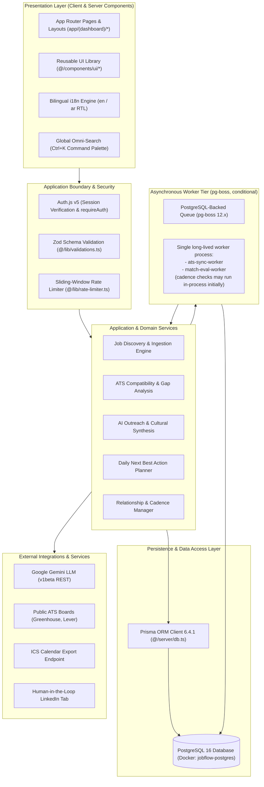
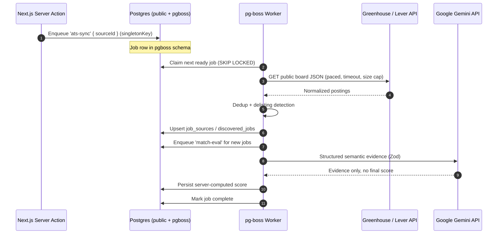
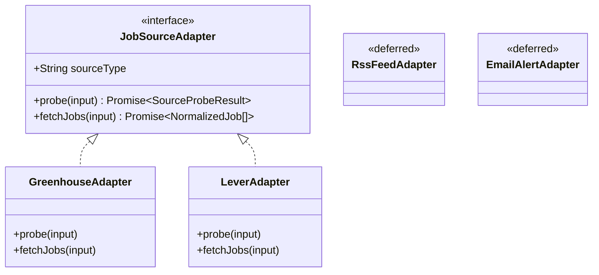

# JobFlow AI — System Architecture & Technical Design
**Document ID:** `docs/SYSTEM_ARCHITECTURE.md`  
**Status:** Approved Technical Architecture — aligned to `docs/EXECUTION_STRATEGY.md` v3.0  
**Version:** 3.0  
**Author:** Principal Software Architect  

---

## 1. High-Level Architecture Overview

JobFlow AI is structured as a **Clean, Multi-Layered Next.js 16 Application** leveraging modern React 19 primitives, Server Actions, and PostgreSQL persistence. Background work uses `pg-boss` **only when a long-lived worker host exists**; the queue is not part of the request path and is not assumed to be available in a serverless deployment.



---

## 2. Layered Architecture Specifications

### 2.1 Presentation Tier
- **Framework**: Next.js 16.4.3 with React 19.
- **Routing Paradigm**: Next.js App Router with Route Groups `(dashboard)` for authenticated workspace views and `/login` for authentication.
- **Rendering Strategy**:
  - Server Components for initial page loads, metadata extraction, and SEO/data fetching.
  - Client Components (`'use client'`) for interactive widgets (Kanban drag-and-drop, modals, filter bars, Recharts visuals, and `Ctrl+K` command palette).
- **Styling & Theming**: Tailwind CSS 4 with custom dark-mode token palette and bi-directional layout support (`dir="ltr"` / `dir="rtl"`).

### 2.2 Security & Application Boundary
- **Authentication**: Auth.js v5 (`next-auth`) with JWT strategy and HTTP-only encrypted session cookies.
- **Tenant Isolation**: Every server action and database query invokes `requireAuth()` (`src/server/auth.ts`) to extract `session.user.id`. Queries strictly append `where: { userId }`.
- **Validation Pipeline**: Every inbound payload is parsed against strict Zod schemas before domain invocation. Unknown fields are stripped.

### 2.3 Domain Services Layer
1. **Discovery Engine (`src/server/services/discovery/`)**: Orchestrates scheduled ATS polling, normalizes incoming postings, deduplicates by source identity and fingerprint, tracks source health, and detects delistings.
2. **Compatibility Engine (`src/lib/ai/cv-matcher.ts`)**: Computes deterministic tech/seniority/location scores and asks the LLM only for structured semantic evidence. The **server** computes the final score; the model never owns it.
3. **Outreach Synthesis (`src/lib/ai/message-generator.ts`)**: Ingests recipient persona, company background, and conversation goals to craft multi-dialect communications (`AR_EG`, `ENGLISH`, `MSA`) using user-provided facts only.
4. **Action Planner (`src/lib/planner/next-best-action.ts`)**: Evaluates overdue follow-ups, stale contacts, upcoming interviews, and daily quotas to produce prioritized action cards.

---

## 3. Background Job Queue Architecture: `pg-boss` (Conditional)

### 3.1 Verified runtime facts

| Fact | Value | Consequence |
|---|---|---|
| Installed `pg-boss` | `12.38.0` | v12 API; v10 notes (`teamSize`, `teamConcurrency`) are obsolete. |
| Node requirement | `>=22.12.0` | Pin Node 22.12+ (current local: 24.20.0). |
| Next.js requirement | `>=20.9.0` | Next is looser; pg-boss is the binding constraint. |
| PostgreSQL | 16 | Compatible; uses `SKIP LOCKED`. |
| Queue schema | `pgboss` | Managed by `boss.start()`; not a Prisma model. |
| Concurrency options | `localConcurrency`, `batchSize`, `groupConcurrency` | Use these, not `teamSize`. |
| Scheduling | `boss.schedule(name, cron, data?, { tz, key, missed })` | Stored in PostgreSQL; safe to call on boot. |
| Delivery semantics | At-least-once | Every handler must be idempotent. |

### 3.2 Deployment topology

pg-boss requires a **long-lived Node.js process**. It does not work in short-lived serverless functions or platforms that freeze idle processes.

```text
┌─────────────────────────────┐
│ Next.js web process          │
│ - UI, Server Actions         │
│ - Producer: boss.send()      │
└──────────────┬──────────────┘
               │
┌──────────────▼──────────────┐
│ PostgreSQL 16                │
│ - public schema (Prisma)     │
│ - pgboss schema (queue)      │
└──────────────┬──────────────┘
               │
┌──────────────▼──────────────┐
│ Worker process               │
│ - boss.work()                │
│ - discovery / matching jobs  │
│ - graceful shutdown          │
└─────────────────────────────┘
```

- **Works:** Docker Compose/VPS with `web` + `worker`, Fly.io/Render/Railway background worker, Kubernetes Deployment.
- **Does not work:** Vercel-only serverless, Netlify Functions, any host without a long-lived process.
- **Fallback if no worker host:** manual sync from the UI plus an external scheduler (e.g. GitHub Actions cron) calling a protected sync endpoint.

### 3.3 Worker lifecycle

1. Load env; construct `PgBoss` with `schema: 'pgboss'` and an explicit pool limit.
2. `await boss.start()` — installs/verifies the pg-boss schema.
3. `await boss.createQueue(...)` for each queue (idempotent).
4. `boss.work(queue, options, handler)` for each consumer.
5. `boss.schedule(...)` for recurring sync (idempotent).
6. On `SIGTERM`/`SIGINT`: stop accepting work, drain in-flight jobs, `boss.stop({ graceful: true, timeout: 30_000 })`, `prisma.$disconnect()`, exit.
7. On crash: `expireInSeconds` unlocks stalled jobs for redelivery.

### 3.4 Retries, concurrency, and scheduling

```ts
await boss.createQueue('ats-sync', {
  retryLimit: 3,
  retryDelay: 30,
  retryBackoff: true,
  retryDelayMax: 900,
  expireInSeconds: 300,
  deadLetter: 'dead-letter',
  policy: 'stately',
})

await boss.work('ats-sync', { localConcurrency: 2, batchSize: 1 }, async (jobs) => {
  for (const job of jobs) {
    await syncSource(job.data.sourceId) // idempotent upsert
  }
})

await boss.schedule('ats-sync', '0 */6 * * *', null, {
  tz: 'Africa/Cairo',
  key: 'ats-sync',
  missed: 'skip',
})
```

- **Retries:** 3 attempts, exponential backoff to 15 minutes, dead-letter after exhaustion.
- **Idempotency:** `singletonKey: source:${sourceId}:sync`; upsert on `(userId, sourceId, externalId)`; payloads carry stable IDs, not snapshots.
- **Concurrency:** `localConcurrency: 2`, `batchSize: 1` for discovery. Rate-limit per host at 1 request / 500 ms with jitter — queue concurrency is not a rate limiter.
- **Cadence:** default full snapshot every **6 hours** (`syncFrequencyMinutes = 360`), configurable per source; manual sync on demand.
- **Backpressure:** do not scale workers until the DB connection budget is known. Web pool + worker pool + pg-boss pool must fit the Postgres `max_connections`.

### 3.5 Sequence



---

## 4. Pluggable Job Source Adapter Pattern

To add a job board without touching core discovery logic, every ingestor implements a narrow adapter contract. The MVP ships **Greenhouse and Lever only**.

```typescript
// Architectural contract: src/server/services/discovery/types.ts

export type JobSourceType = 'GREENHOUSE' | 'LEVER'

export interface SourceProbeResult {
  ok: boolean
  latencyMs: number
  jobCount?: number
  errorCode?: 'INVALID_TOKEN' | 'RATE_LIMITED' | 'BLOCKED' | 'TRANSIENT' | 'MALFORMED' | 'TIMEOUT'
  errorMessage?: string
}

export interface NormalizedJob {
  sourceType: JobSourceType
  boardToken: string
  externalId: string          // `GREENHOUSE:{token}:{id}` | `LEVER:{token}:{id}`
  companyName: string
  companyKey: string
  title: string
  titleKey: string
  locationText: string | null
  workArrangement: 'REMOTE' | 'HYBRID' | 'ON_SITE' | 'UNKNOWN'
  employmentType: string | null
  department: string | null
  descriptionText: string
  descriptionHash: string
  jobUrl: string
  applyUrl: string | null
  publishedAt: Date | null
  sourceUpdatedAt: Date | null
  salaryMin: number | null
  salaryMax: number | null
  salaryCurrency: string | null
  fingerprint: string
}

export interface JobSourceAdapter {
  sourceType: JobSourceType
  probe(input: { boardToken: string }): Promise<SourceProbeResult>
  fetchJobs(input: { boardToken: string }): Promise<NormalizedJob[]>
}
```



**Adapter rules**

- Fixed host allowlist per adapter; no arbitrary URLs.
- 10 s probe timeout; 30 s sync timeout; streamed size cap.
- `probe()` maps 404 → `INVALID_TOKEN`, 401/403 → `BLOCKED`, 429 → `RATE_LIMITED`, 5xx/timeout → `TRANSIENT`.
- `fetchJobs()` returns normalized data only; persistence lives in the manager.
- A `200` with zero jobs is valid.
- RSS and email adapters are deferred until their own milestone.

---

## 5. Bilingual Layout & Internationalization (i18n)

The architecture natively supports Egyptian Arabic (`ar`) and English (`en`):
1. **Dynamic Directionality**: Toggling language immediately sets `<html dir="rtl" lang="ar">` or `<html dir="ltr" lang="en">`.
2. **Tailwind Logical Classes**: The UI uses CSS logical properties (e.g. `ms-4`, `me-4`, `ps-3`, `pe-3`, `start-0`, `end-0`) rather than directional primitives (`ml-4`, `mr-4`, `left-0`), guaranteeing perfect symmetrical mirroring across layouts.
3. **Typography**: Arabic font rendering is prioritized with modern Egyptian-preferred sans-serif fonts (`system-ui`, `Cairo`, `Noto Sans Arabic`).

